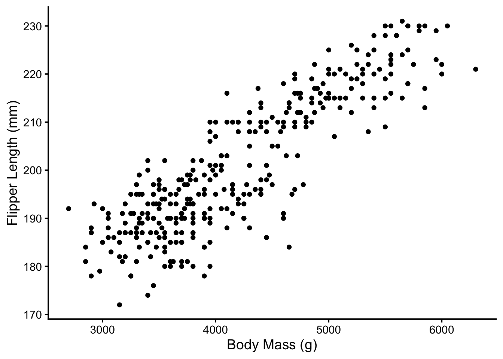
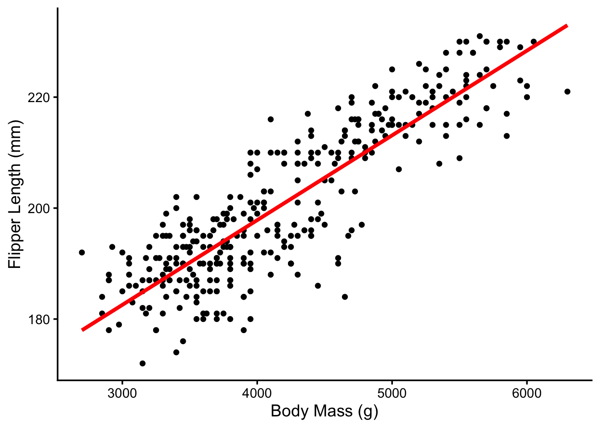
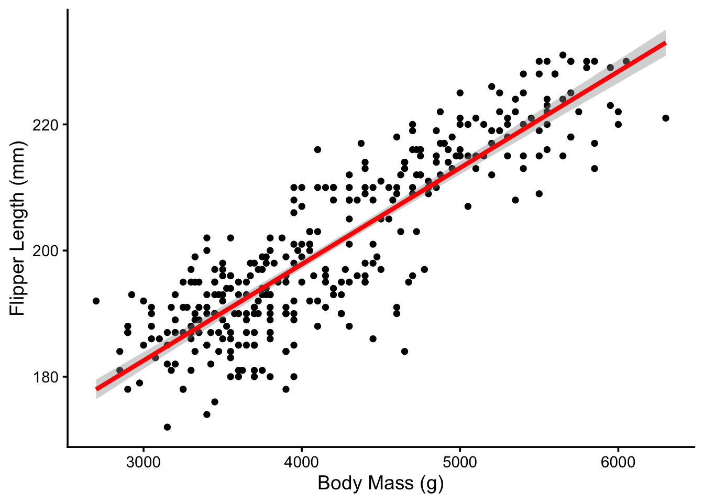
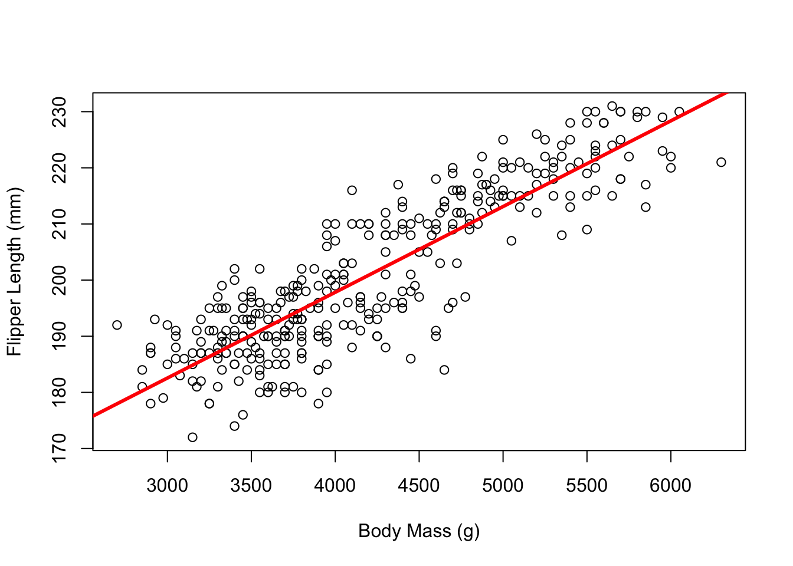
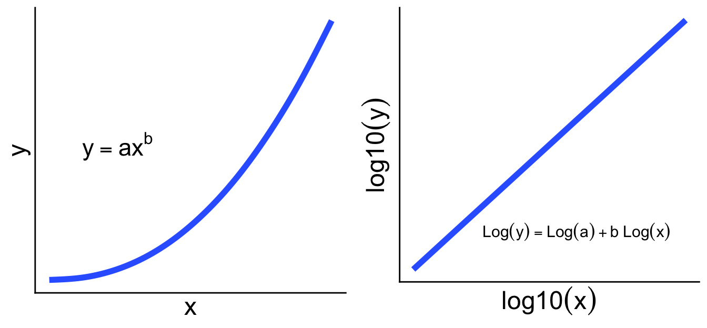
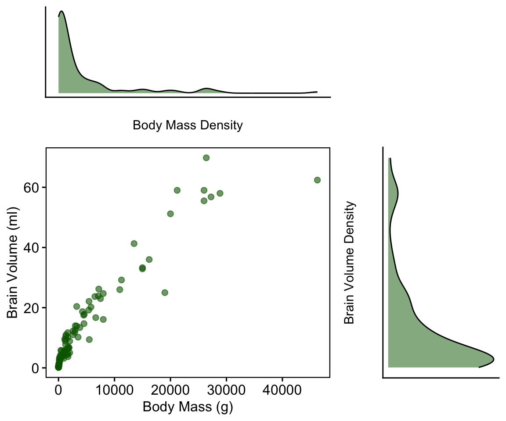
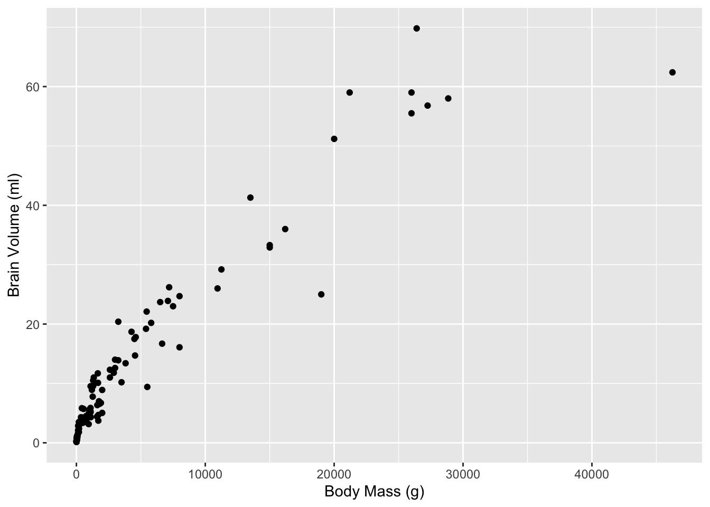
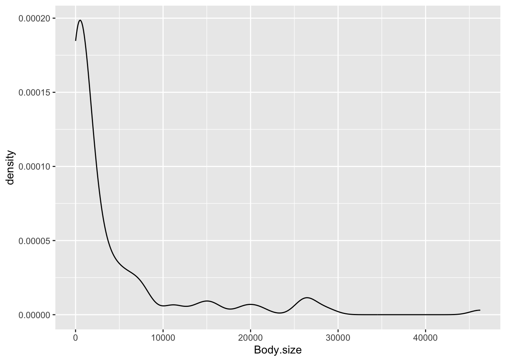
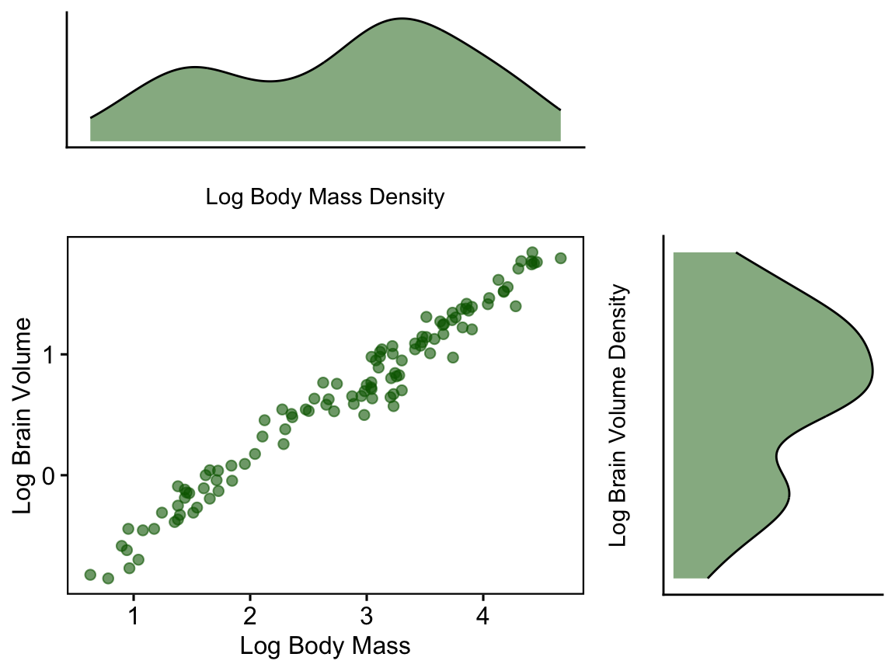
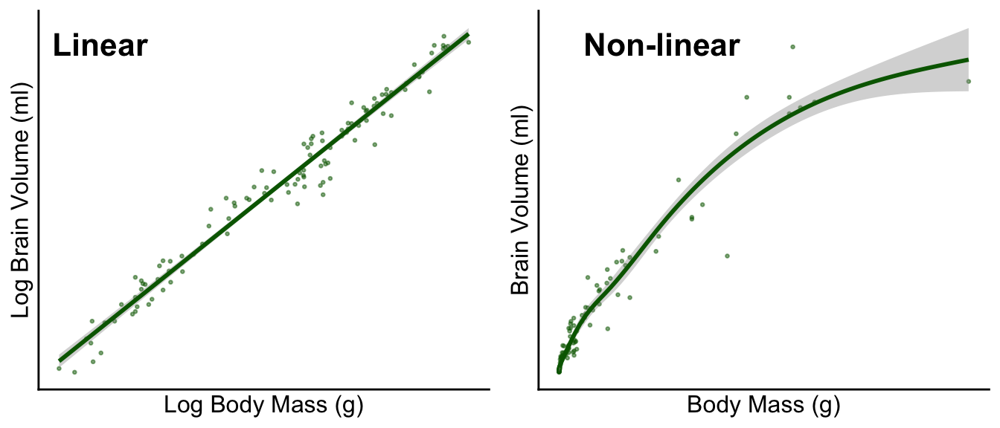

*Updated by Dr. Robert Treharne on 16 October 2026.*

This second part of Topic 5 introduces linear regression: modelling the
relationship between numeric variables, checking the fitted model, and using
logarithmic transformations where they improve the model.

:::{important}
Complete [Topic 5 Part I: Analysis of Variance](topic-5.md) before starting
this chapter. Both parts use the same linear-model workflow in R.
:::

## Files for Part II

Create a `LIFE707/Topic_5` folder and download the regression files before
starting. They are included with this book, so you do not need to return to
Canvas.

- <a href="/data/topic-5-anova-linear-regression/Braindata.csv?download=1">Braindata.csv</a>
- <a href="/data/topic-5-anova-linear-regression/monkeys.txt?download=1">monkeys.txt</a>
- <a href="/data/topic-5-anova-linear-regression/retinoblastoma_Y79_data.csv?download=1">retinoblastoma_Y79_data.csv</a>
- <a href="/data/topic-5-anova-linear-regression/penguins.csv?download=1">penguins.csv</a>

In this workshop, you’ll be looking at regression in R. Try and remember that this is a complex topic and we’re not going to cover it all here. Most importantly, make sure you understand the logic behind these methods. The mathematics can be dealt with by the computer.

This document contains the entire workshop covering linear regression, data transformation and non-linear regression. Take it at your own pace and don’t be afraid to take breaks and ask for help.

Watch this introduction to linear regression before beginning the workshop.

<iframe src="https://liverpool.cloud.panopto.eu/Panopto/Pages/Embed.aspx?id=3bc88d4b-d15a-49b5-8cd8-b37200effce9&autoplay=false&offerviewer=true&showtitle=true&showbrand=true&captions=true&interactivity=all" style="border: 1px solid #464646; width: 100%; aspect-ratio: 16 / 9; box-sizing: border-box;" allowfullscreen allow="autoplay" aria-label="Panopto Embedded Video Player" aria-description="Introduction to linear regression"></iframe>
<div aria-hidden="true" style="height:2rem;"></div>


## Introduction

Much of biology is concerned with relationships between numeric variables. For example:

- We sample fish and measure their length and weight because we want to understand how weight scales with respect to length.
- We manipulate temperature and measure heart rate in humans because we want to characterise their thermal tolerance.

You already know about a technique for analysing associations between numeric variables (correlation). A correlation coefficient only quantifies the strength and direction of an association between two variables. It will be close to zero if there is no association between the variables; a strong association is implied if the coefficient is near -1 or +1. A correlation coefficient tells us nothing about the form of a relationship. Nor does it allow us to make predictions about the value of one variable from the value of a second variable. Regression, which is the focus of this section, does allow this because it involves fitting a line through the data.

In the relationships mentioned above the goal is to understand how one numeric variable depends on the values of another. Graphically, we evaluate such dependencies using a scatter plot. We may be interested in knowing:

1.  **Are the variables related or not?** There’s not much point studying a relationship that isn’t there.
2.  **Is the relationship positive or negative?** Sometimes we can answer a scientific question just by knowing the direction of a relationship.
3.  **Is the relationship a straight line or a curve?** It is important to know the form of a relationship if we want to make predictions.

Although sometimes it may be obvious that there is a relationship between two variables from a plot of one against the other, at other times it may not. We might not be very confident in judging evidence of a positive relationship between two variables. Maybe the pattern that we perceive can just be explained by sampling variation, or maybe it can’t. Clearly it would be useful to have a measure of how likely it is that the relationship could have arisen as a result of sampling variation. In addition to judging the statistical significance of a relationship, we may also be interested in describing the relationship mathematically - i.e. finding the equation of the best fitting line through the data. A linear regression analysis allows us to do all this.


## Correlation or regression?

Whilst regression and correlation are both concerned with associations between numeric variables they are different techniques and each is appropriate under different circumstances. This is a frequent source of confusion. Which technique is required for a particular analysis depends on the way the data were collected and the purpose of the analysis. There are two broad questions to consider:


### Where do the data come from?

Think about how the data have been collected. If the data are from an experimental study where one of the variables has been manipulated, then choosing the best analysis is easy. We should use a regression analysis, in which the predictor variable is the experimentally manipulated variable and the response variable is the measured outcome. The fitted line from a regression analysis describes how the outcome variable depends on the manipulated variable - **it describes the causal relationship between them**.

It is generally inappropriate to use correlation to analyse data from an experimental setting. A correlation analysis examines association but does not imply the dependence of one variable on another. This is why we often say: **Correlation does not necessarily imply causation.** Since there is no distinction of response or predictor variables, it doesn’t matter which way round we do a correlation. The phrase “which way round” doesn’t even make sense in the context of a correlation.

If the data are from an observational study, either method may be appropriate. Time to ask another question:


### What is the goal of the analysis?

Think about what question is being addressed. A correlation coefficient only quantifies the strength and direction of an association between two variables, it tells us nothing about the form of a relationship. Nor does it allow us to make predictions about the value of one variable from the value of a second variable. A regression does allow this because it involves fitting a line through the data - i.e. there’s a model for the relationship.

This means that if the goal of an analysis is to understand the form of a relationship between two variables, or to use a fitted model to make predictions, we have to use regression. If we just want to know whether two variables are associated or not, the direction of the association, and whether the association is strong or weak, then a correlation analysis is sufficient. It is better to use a correlation analysis when the extra information produced by a regression is not needed, because the former will be simpler and potentially more robust.


## Linear regression

Linear regression models account for a straight line relationship between two numeric variables, i.e. they describe how the response variable changes in response to the values of the predictor variable. It is conventional to label the response variable as ‘y’ and the predictor variable as ‘x’. When we present such data graphically, the response variable always goes on the y-axis and the predictor variable on the x-axis. **Try not to forget this convention!**

How do we decide which is to be used as the response variable and which as the predictor variable? The decision is fairly straightforward in an experimental setting: the manipulated variable is the predictor variable, and the measured outcome is the response variable. Things may not be so clear cut when we are working with data from an observational study as it may not be obvious that one variable depends upon the other (in a causal sense). In regression it matters which way round we designate the response and predictor variables. If you have two variables A and B, the relationship you find from a regression will not be the same for A against B as for B against A.


## Flipping penguins

Let’s take a data set of Palmer penguins and see how linear regression works in practice!

Watch this short walkthrough before working through the penguin example.

<iframe src="https://liverpool.cloud.panopto.eu/Panopto/Pages/Embed.aspx?id=a66cffcf-a4d7-46af-b713-b4e50088ad2c&autoplay=false&offerviewer=true&showtitle=true&showbrand=true&captions=true&interactivity=all" style="border: 1px solid #464646; width: 100%; aspect-ratio: 16 / 9; box-sizing: border-box;" allowfullscreen allow="autoplay" aria-label="Panopto Embedded Video Player" aria-description="Regression Part 2"></iframe>
<div aria-hidden="true" style="height:2rem;"></div>

:::{warning}
The penguin dataset used in this workshop is different from the dataset used
in the video.
:::

``` r
# Here I've used read_csv from tidyverse, but the base read.csv also works
penguins <- read_csv("penguins.csv")
```

It may seem reasonable to hypothesise that penguins with a larger body mass will also have longer flippers. Furthermore, we might hypothesise that larger flippers are the **result** of being a larger animal. We can use linear regression to assess this potential relationship.

First, it’s a good idea to plot the data and get a feel for what it looks like.

``` r
# introducing a few variations on how to produce a ggplot

p <- penguins %>% ggplot(aes(x = body_mass_g, y = flipper_length_mm)) + # data piped straight to ggplot
  geom_point(size = 1.5) + # control the size of the point
  xlab("Body Mass (g)") + ylab("Flipper Length (mm)") + # an alternative to xlab and ylab
  theme_classic(base_size=14)

p # the object p contains all the data for the plot, and you just give its name when you want to plot it
```



This looks to satisfy the key assumption of linear regression: that the relationship can be described by a *linear* model (a straight line). Note that body mass is on the x-axis because this is our predictor variable.


### Step 1 - Fit the model

The first step of any regression is to fit the model. In the cases of linear regression, this means calculating the line of best fit. In R, we use a function that you are already familiar with; **lm()**.

``` r
m1 <- lm(flipper_length_mm ~ body_mass_g, data = penguins)
```

This should look quite familiar. We have to assign two arguments:

1.  The first argument is a formula. We know this because it includes a ‘tilde’ symbol: ~. The variable name on the left of the ~ should be the response variable. The variable name on the right should be the predictor variable. These are flipper length and body mass, respectively. **Make sure you get these the right way round when carrying out regression**.

2.  The second argument is the name of the data frame that contains the two variables listed in the formula (penguins).

By inspecting the object we have created, we can view the values for the slope (*b*) and intercept (*a*). Remember that the general form of the linear model is <span class="math inline">\\y = a + bx\\</span> so these values describe the line of best fit.

``` r
m1
```

:::{dropdown} Show expected output
```text
##
## Call:
## lm(formula = flipper_length_mm ~ body_mass_g, data = penguins)
##
## Coefficients:
## (Intercept)  body_mass_g
##   136.72956      0.01528
```
:::

We can plot this line over the data on our scatterplot.

``` r
p + geom_smooth(method = "lm", se = FALSE, color = "red", size = 1.5)
```




### Step 2: Assess the model

A detailed summary of the properties of our model can be called up using the `summary` function.

``` r
summary(m1)
```

:::{dropdown} Show expected output
```text
##
## Call:
## lm(formula = flipper_length_mm ~ body_mass_g, data = penguins)
##
## Residuals:
##      Min       1Q   Median       3Q      Max
## -23.7626  -4.9138   0.9891   5.1166  16.6392
##
## Coefficients:
##              Estimate Std. Error t value Pr(>|t|)
## (Intercept) 1.367e+02  1.997e+00   68.47   <2e-16 ***
## body_mass_g 1.528e-02  4.668e-04   32.72   <2e-16 ***
## ---
## Signif. codes:  0 '***' 0.001 '**' 0.01 '*' 0.05 '.' 0.1 ' ' 1
##
## Residual standard error: 6.913 on 340 degrees of freedom
##   (2 observations deleted due to missingness)
## Multiple R-squared:  0.759,  Adjusted R-squared:  0.7583
## F-statistic:  1071 on 1 and 340 DF,  p-value: < 2.2e-16
```
:::

This output is a little more complex than you may be used to so let’s go through it piece-by-piece.

First we have the “**Call**” and “**Residuals**” sections. There’s nothing much we need here so we won’t dwell on it. The Call is simply the code that was used to fit the model and as long as it matches what we expect, that’s all we need from it. The Residuals just gives us some summary stats about the residuals of our model (see the lecture videos for more information about residuals). Again, no need to pay much attention to these here.

The “**Coefficients**” section contains much more useful information.

    Coefficients:
                 Estimate Std. Error t value Pr(>|t|)
    (Intercept) 1.367e+02  1.997e+00   68.47   <2e-16 ***
    body_mass_g 1.528e-02  4.668e-04   32.72   <2e-16 ***

The “**Estimate**” column shows us the estimated intercept and slope of the model. We saw these earlier when we printed the fitted model object to the console.

Staying with this table, the next three columns (**Std. Error**, **t value** and **Pr(\>\|t\|)**) show us the standard error associated with each coefficient, the corresponding t-statistics, and the p-values. Remember standard errors? These are a measure of the variability of the sampling distribution associated with something we estimate from a sample. You have met these before in the context of sample means. One can calculate a standard error for many different kinds of quantities, including the intercept and slope of a regression model. And just as with a mean, we can use the standard errors to evaluate the significance of the coefficients via t-statistics.

In this case, the p-values associated with these t-statistics indicate that the intercept is significantly different from zero (p \< 0.001), and that the slope is significantly different from zero (p\<0.001).

If you’re interested in visualising what the standard error of a regression means, there is a way to plot it. The shading around the regression line here signifies the standard error.

``` r
p + geom_smooth(method = "lm", se = TRUE, color = "red", size = 1.5)
```



Finally, we have some vital model stats, in particular the **R<sup>2</sup>**.

    Residual standard error: 6.913 on 340 degrees of freedom
      (2 observations deleted due to missingness)
    Multiple R-squared:  0.759, Adjusted R-squared:  0.7583
    F-statistic:  1071 on 1 and 340 DF,  p-value: < 2.2e-16

This shows the R-squared (R<sup>2</sup>) of our model. It tells you what proportion (sometimes expressed as a percentage) of the variation in the data is explained, or accounted for, by the fitted line. If R<sup>2</sup> = 1 the line passes through all the points on the graph (all the variation is accounted for) and if R<sup>2</sup> = 0 the line explains little or none of the variation in the data. The R<sup>2</sup> value here is 0.76, indicating 76% of the variation is explained by this model. This is very respectable, but still indicates that there are other sources of variation which remain unexplained by the line.

We also have the **F statistic** which is used to calculate the **p-value**. This assesses the significance of the overall fit of the model.


## Reporting a regression

*There is a significant positive relationship between body mass (g) and flipper length (mm) in the Palmer penguins (y=136.73 + 0.015x, F = 1071, d.f. = 1,340, p \< 0.001).*

Don’t forget to quote both degrees of freedom in the result. These are obtained from the summary information and should be given as the slope degrees of freedom first (which is always 1), followed by the error degrees of freedom.

If the results are being presented only in the text it is usually appropriate to specify the regression equation as well as the significance of the relationship as this allows the reader to see in which direction and how steep the relationship is, and to use the equation in further calculations. It may also be useful to give the units of measurement (though these should already be stated in the Methods). Often however, we will want to present the results as a figure, showing the original data and the fitted regression line. In this case, most of the statistical detail can go in the figure legend instead.


## Plotting a regression

I’ve done my plots here in ggplot2 (which is pretty) but you can also plot it all in base R:

``` r
plot(flipper_length_mm ~ body_mass_g, data = penguins,
     xlab = "Body Mass (g)", ylab = "Flipper Length (mm)")
abline(m1, col = "red", lwd = 3) #adds the regression line from the model (m1)
```




## Non-linearity

Sometimes, no matter how many ritual sacrifices you make to the data gods, you collect data that isn’t linear. As you know from the lecture videos, there are 2 options for how to treat non-linear data.

1.  Transform to make the data linear
2.  Fit a non-linear model


## Transforming Data

One way to deal with non-linear data is to use a mathematical transformation to force it to be linear.

One very common type of non-linearity in real data is a power-law relationship.
Applying a log transformation can turn this curved relationship into a linear
one. Once this has been achieved, we can use linear regression on the
transformed data.



:::{tip} Why a log transformation can help
Some biological relationships follow a power law, where the response `y`
changes with the predictor `x` according to:

```{math}
y = ax^b
```

Taking the same logarithm of both variables gives a straight-line form:

```{math}
\log_{10}(y) = \log_{10}(a) + b\log_{10}(x)
```

This is why plotting `log10(y)` against `log10(x)` can make a curved
power-law relationship suitable for a linear regression. The slope of that
line is `b`.

`log10()` is not the only valid choice. It is often convenient when values
span orders of magnitude, but `log2()` is especially useful when doubling and
halving are meaningful. For example, when comparing gene expression in a
treatment with a control, a `log2` fold-change of 1 means expression has
doubled, while a value of -1 means it has halved. Natural logs (`log()` in R)
are also common. Changing the log base rescales the slope and intercept, but
does not change whether the relationship is linear or the statistical
conclusion; use the same base consistently and choose one that makes your
results easiest to interpret.
:::


### Marsupial example

Let’s look at an example from the lectures. Here we have data on brain and body size in two groups of animals: Cetaceans and marsupials.

``` r
brains <- read.csv("Braindata.csv")
```

:::{dropdown} Show expected output
```text
##     Order                    Species Brain.size Body.size
## 1 Cetacea         Balaena_mysticetus       2738  79691179
## 2 Cetacea Balaenoptera_acutorostrata         NA   5587094
## 3 Cetacea   Balaenoptera_bonaerensis         NA        NA
## 4 Cetacea      Balaenoptera_borealis       4900  22106252
## 5 Cetacea         Balaenoptera_edeni         NA  20000000
## 6 Cetacea      Balaenoptera_musculus       3636 154321304
```
:::

Let’s start by focusing on the marsupials. We can see when we plot the data that what we have here looks both nonlinear and skewed. You can see from the plot below that both brain size and body mass are heavily skewed towards the smaller values. Similarly, the scatterplot shows the data is very clearly non-linear.



(This plot above is done with some R layout, which I won’t go into, but you can try to generate similar plots using `geom_point` and `geom_density` if you like.)

``` r
marsupials <- subset(brains, Order == "Marsupial")

# scatter plot
marsupials %>% ggplot(aes(x=Body.size, y=Brain.size)) +
  geom_point() +
  xlab("Body Mass (g)") + ylab("Brain Volume (ml)")
```



``` r
#density plot, change for Brain.size
marsupials %>% ggplot(aes(x=Body.size)) +
  geom_density()
```



Let’s log transform both variables and see if that helps.

``` r
marsupials$log.brain <- log10(marsupials$Brain.size)
marsupials$log.body <- log10(marsupials$Body.size)
```



As you can see, the transformed data is much easier to work with. The data looks linear and the distributions look more evenly spread. The distributions of the data **don’t have to be normal to perform a regression** by the way. But very strongly skewed data as we saw in the untransformed data introduces problems with fitting the model. For example, you can see in the untransformed data that it is very clearly heteroscedastic (variance changes across the sample). This means that if I were to try and fit a model to those data, the residuals would be much greater at higher values of x and y. As you can see from the plots below, this means the standard errors of the model (the shaded area around the fitted line) get much larger at higher values of body and brain size. This is the case whether you fit a linear (left) or non-linear model (right).



> TASK Now that we have used a log transform to get linear data, we can analyse it with linear regression. Have a go (by modifying the code we used for flipper vs body size in penguins) and see if you can interpret the results.


## Exercises

Create a new R script called `topic_5_part_2_exercises.R` in your
`LIFE707/Topic_5` folder before you begin. Use it to save your code and notes
as you work through the exercises.

The following provide additional practice. Attempt each exercise before looking
back at the chapter or asking for help.

### Exercise 1: Monkeys

The file <a href="/data/topic-5-anova-linear-regression/monkeys.txt?download=1">monkeys.txt</a>
contains group size and range size for 59 monkey populations in southern
Africa.

1. Plot the data to assess whether group size and range size (ha) may be
   related.
2. Fit a linear model to test that relationship and use it to predict range
   size for groups of 8, 14, 20, and 26 individuals.
3. Fit a second model with rainfall (mm) as the predictor and range size as the
   response. Consider which relationships are likely to be causal.

### Exercise 2: Retinoblastoma

The file <a href="/data/topic-5-anova-linear-regression/retinoblastoma_Y79_data.csv?download=1">retinoblastoma_Y79_data.csv</a>
contains the diameter (micrometres) and resting membrane potential
(microvolts) of retinoblastoma cells.

1. Plot membrane potential on the y-axis against diameter on the x-axis, then
   fit a linear model to describe how membrane potential varies with diameter.

## Video Walkthroughs

Use this walkthrough after attempting the exercises to review the approach and results.

<iframe src="https://liverpool.cloud.panopto.eu/Panopto/Pages/Embed.aspx?id=3bc88d4b-d15a-49b5-8cd8-b37200effce9&autoplay=false&offerviewer=true&showtitle=true&showbrand=true&captions=true&interactivity=all" style="border: 1px solid #464646; width: 100%; aspect-ratio: 16 / 9; box-sizing: border-box;" allowfullscreen allow="autoplay" aria-label="Panopto Embedded Video Player" aria-description="Regression exercise video"></iframe>
<div aria-hidden="true" style="height:2rem;"></div>
