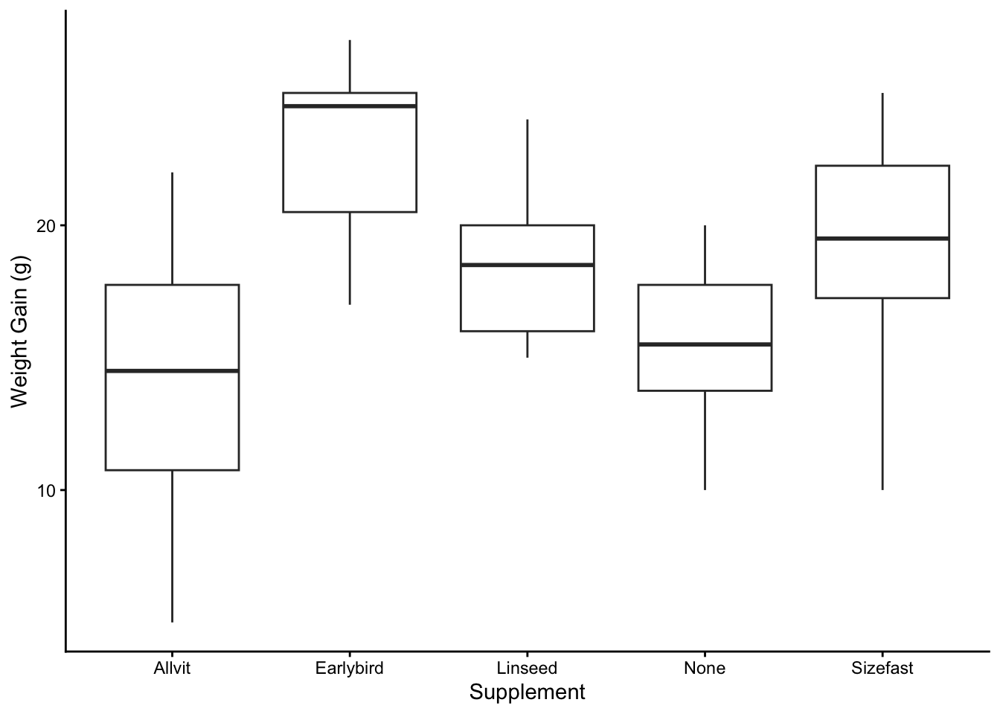
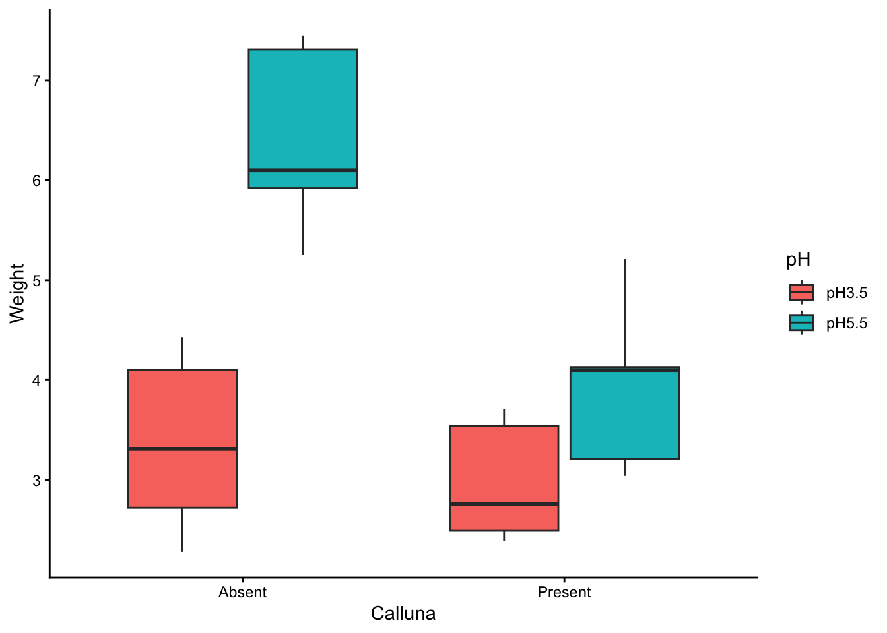
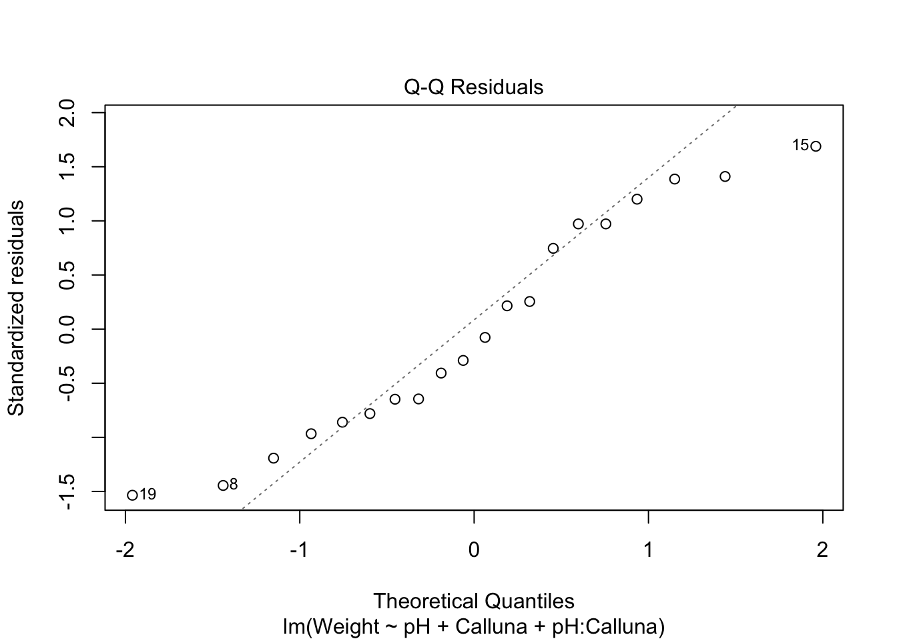
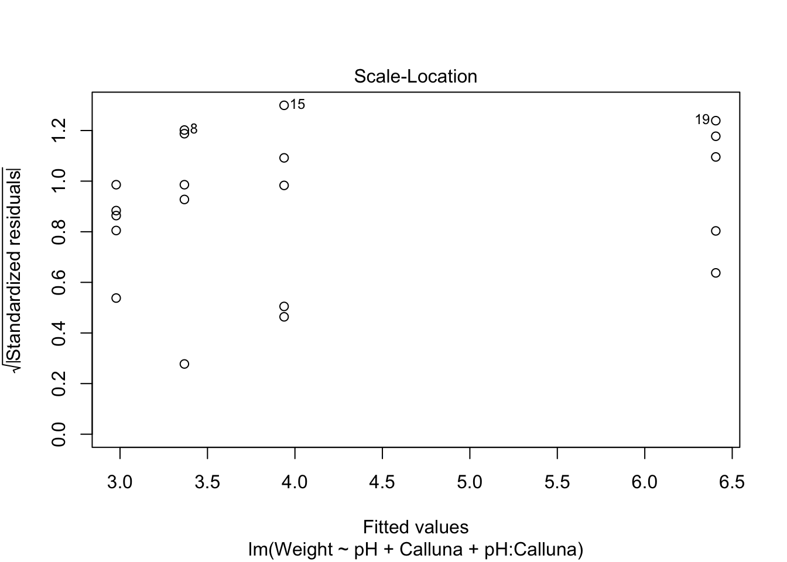
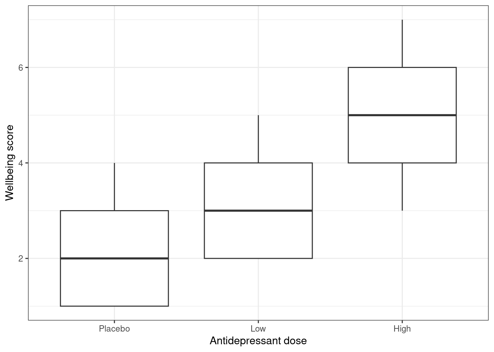
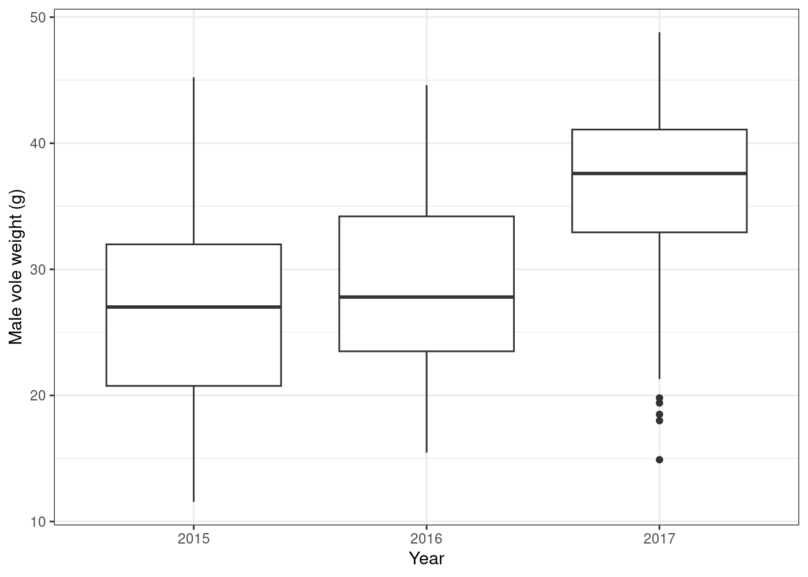

*Updated by Dr. Robert Treharne on 16 October 2026.*

This first part of Topic 5 introduces analysis of variance (ANOVA): when to
use one- and two-way ANOVA, how to run the supplied R code, and how to
interpret model output.

:::{important}
Complete [Topic 4](topic-4.md) before starting this chapter. You will need to
be able to read data into R, inspect data frames, and clean or reshape data
where necessary.
:::

## Files for Part I

Create a `LIFE707/Topic_5` folder and download the ANOVA files before starting.
They are included with this book, so you do not need to return to Canvas.

- <a href="/data/topic-5-anova-linear-regression/corncrake.csv?download=1">corncrake.csv</a>
- <a href="/data/topic-5-anova-linear-regression/Cuttlefish.csv?download=1">Cuttlefish.csv</a>
- <a href="/data/topic-5-anova-linear-regression/Festuca.csv?download=1">Festuca.csv</a>
- <a href="/data/topic-5-anova-linear-regression/antid1.txt?download=1">antid1.txt</a>
- <a href="/data/topic-5-anova-linear-regression/voles.csv?download=1">voles.csv</a>

## Introduction

In this workshop you will learn how to perform one and two-way ANOVAs. The key thing to understand before you embark on this workshop is the kind of questions these analyses ask.

- One-way ANOVA tests for a difference in mean between more than two levels of a categorical variable (eg. 3 different treatments in a drug trial)

- Two-way ANOVA tests for a difference in mean of a continuous variable between two different factors (eg. different drugs in a trial compared at two different doses)

Watch this overview before starting the workshop for an introduction to ANOVA
and the R workflow used below.

<iframe src="https://liverpool.cloud.panopto.eu/Panopto/Pages/Embed.aspx?id=11618219-e857-49bd-a78b-b4e500875581&amp;autoplay=false&amp;offerviewer=true&amp;showtitle=true&amp;showbrand=true&amp;captions=true&amp;interactivity=all" style="border:1px solid #464646;position:absolute;top:0;left:0;width:100%;height:100%;box-sizing:border-box;" allowfullscreen allow="autoplay" aria-label="Panopto Embedded Video Player" aria-description="ANOVA overview"></iframe>

<div aria-hidden="true" style="height:2rem;"></div>


## One-way ANOVA


### Data

The corncrake underwent severe declines in the UK thought to be due to changes in farming practices. Captive breeding and reintroduction programmes were introduced to try to help supplement the wild population. We want to determine the success of 4 different supplements (*the predictor*) for increasing initial growth (*the response*) in the captively bred hatchlings. The data is from an experiment in which groups of 8 hatchlings were fed with different supplements. A fifth group of 8 hatchlings served as the control group. The data here contains measurements of how much weight each hatchling had gained over the week.


Let’s load in some data. Here we have some data about corncrake (*Crex crex*). You should be familiar with `read.csv` or `read_csv` for reading in .csv files. Here we’ve used the argument `stringsAsFactors = TRUE` to read in the *Supplement* field as a factor. If you remember, this means a field that can take a limited number of discrete values, in this case different dietary supplements that were fed to the birds.

``` r
corncrake <- read.csv("corncrake.csv", stringsAsFactors = TRUE)
summary(corncrake)
```

:::{dropdown} Show expected output
```text
##      Supplement   WeightGain
##  Allvit   :8    Min.   : 5.00
##  Earlybird:8    1st Qu.:15.00
##  Linseed  :8    Median :18.50
##  None     :8    Mean   :18.05
##  Sizefast :8    3rd Qu.:21.25
##                 Max.   :27.00
```
:::

``` r
# Alternatively, you could do something like:
corncrake <- read.csv("corncrake.csv")
corncrake <- corncrake %>% mutate(Supplement = factor(Supplement,
                levels=c("None","Allvit","Earlybird","Linseed","Sizefast")))
# summary(corncrake)
# This would set the first level of the supplement factor as 'None', ie no supplement control
```


### Plotting

As with many analyses, the first thing to do is visualise your data. This may be something you think of as a final step for reporting your results but it’s also incredibly useful to get a feel for your data as you’re getting started. We can do this using a boxplot. You know how to do this from the data visualisation workshop.

> TASK Plot a boxplot of the corncrake supplement data

Watch this short walkthrough if you would like help completing the task.

<iframe src="https://liverpool.cloud.panopto.eu/Panopto/Pages/Embed.aspx?id=199f73ba-262e-4f8a-81cd-b37200945386&amp;autoplay=false&amp;offerviewer=true&amp;showtitle=true&amp;showbrand=true&amp;captions=true&amp;interactivity=all" style="border:1px solid #464646;position:absolute;top:0;left:0;width:100%;height:100%;box-sizing:border-box;" allowfullscreen allow="autoplay" aria-label="Panopto Embedded Video Player" aria-description="ANOVA workshop exercise video"></iframe>

<div aria-hidden="true" style="height:2rem;"></div>


### Analysis

Carrying out ANOVA in R is quite simple but there is more than one step. The first involves a process known as **model fitting**. This is the step where R calculates the relevant means, along with the additional information needed to generate the results in step two. We call this step model fitting because an ANOVA is a type of model for our data: it is a model that allows the mean of a variable to vary among groups.

How do we fit an ANOVA model in R? We will do it using the `lm()` function. *lm* in this case stands for ‘linear model’. So… an ANOVA model is just a special case of the linear model (keep this in mind when comparing the code for ANOVA and linear regression). Here is how we fit a one-way ANOVA in R, using the corncrake data.

``` r
corncrake_model <- lm(WeightGain ~ Supplement, data = corncrake)
```

If you’ve already looked at regression, this kind of code should look familiar. If not, take it slow and try to understand what each part does.

The first argument is a formula. We know this because it includes a *tilde* symbol: ~. The variable name on the left of the ~ must be the numeric **response variable** whose means we want to compare among groups. The variable on the right should be the **predictor variable** that says which group each observation belongs to. These are *WeightGain* and *Supplement*, respectively.

The second argument is the name of the data frame that contains the two variables listed in the formula. As you have included this, there is no need to include the `$` to indicate the column, you have told R which dataset to use.

The second step of performing your analysis uses the `anova` function. This is what we need to calculate a p-value to help us determine whether there is statistical support for a difference among the group means. It also tells us things like degrees of freedom, sums of squares, mean squares, and the F-ratio.

``` r
anova(corncrake_model)
```

:::{dropdown} Show expected output
```text
## Analysis of Variance Table
##
## Response: WeightGain
##            Df Sum Sq Mean Sq F value   Pr(>F)
## Supplement  4 357.65  89.413  5.1281 0.002331 **
## Residuals  35 610.25  17.436
## ---
## Signif. codes:  0 '***' 0.001 '**' 0.01 '*' 0.05 '.' 0.1 ' ' 1
```
:::

Notice that all we did was pass the anova function one argument: the name of the fitted model object.

Let’s step through the output to see what it means. The first line just informs us that we are looking at an ANOVA table, i.e. a table of statistical results from an analysis of variance. The second line just reminds us what variable we analysed.

The **F-ratio** (variance ratio) is the key term. This is the test statistic. It provides a measure of how large and consistent the differences between the means of the five different treatments are. Larger values indicate clearer differences between means.

From the mean squares, you can see that $89.413 / 17.436 = 5.128$, i.e. the *F* statistic.

Here mean square (MS) is the sum of squares (SS) divided by degrees of freedom (df): $MS = SS / df$. The test statistic is $F = MS_{group} / MS_{resid} = 89.413 / 17.436 = 5.128$. The degrees of freedom are calculated as follows. There are 4 parameters fitted for group (4 different supplements versus the control group), hence four degrees of freedom are taken up fitting group. One degree of freedom is taken for the grand mean of the whole data. If there are 40 data points in total (try `nrow(corncrake)`) that leaves 35 degrees of freedom remaining in the residuals.

The **p-value** (Pr(\>F)) gives the probability that the observed differences between the means, or a more extreme difference, could have arisen through sampling variation under the null hypothesis. Remember your null hypothesis here is that there is no difference between groups. As always, the p-value of 0.05 is used as the significance threshold, and we take p \< 0.05 as evidence that at least one of the treatments is having an effect. For the corncrake data, the value is 5.1, and the probability (p) of getting an F-ratio this large is given by R as 0.0023, (less than 0.05). This provides good evidence that there are differences in weight gain between at least some of the treatments.

So far so good! The test that we have just carried out is called the **global test of significance**. It goes by this name because it doesn’t tell us anything about which means are different. The analyses suggest that there is an effect of supplement on weight gain, but some uncertainty remains because we have only established that there are differences among at least some supplements. **A global test doesn’t say which supplements are better or worse**. This could be very important. If the significant result is generated by all supplements being equally effective (hence differing from the control but not from each other) we would draw very different conclusions than if the result was a consequence of one supplement being very effective and all the others being useless. Our result could even be produced by the supplements all being less effective than the control!

Once you have a significant result, you should always have another look at the plot to see where the differences might lie.



What looking at the means tells us is that the effect of the supplements is generally to increase weight gain (with one exception, ‘Allvit’) relative to the control group (‘None’), and that it looks as though ‘Earlybird’ is the most effective, followed by ‘Sizefast’ and ‘Linseed’.

As good scientists, we need a more rigorous way of testing where the significant differences between treatments occur. A number of tests exist as ‘add ons’ to ANOVA which enable you to do this. These are called **post hoc multiple comparison tests**.


## Post-hoc testing

In the corncrake example above, the tests have told us about **global significance** but nothing about where the differences might be, i.e. *which* treatments were effective?

The general method we will use is called a **post hoc multiple comparisons test**. The phrase ‘*post hoc*’ refers to the fact that these tests are conducted without any particular prior comparisons in mind. The words ‘multiple comparisons’ refer to the fact that they consider many different pairwise comparisons. We are going to work with the most widely used test: the Tukey multiple comparison test.

Focusing on the corncrake example:

First, we have to convert the linear model object into a different kind of model object using the **aov** function.

``` r
corncrake_aov <- aov(corncrake_model)
```

We don’t really need to understand what this is doing but **aov** prepares the model so that we can perform a Tukey HSD test. Notice that we gave the new object its own name (corncrake_aov) because we need to use it in the next step.

It is easy to perform a Tukey HSD test once we have the ‘aov’ version of our model. There are a few different options. Here is how to do this using the TukeyHSD function. Note that we apply the TukeyHSD function to the ‘aov’ object, **not the original lm object**.

``` r
TukeyHSD(corncrake_aov, ordered = TRUE)
```

:::{dropdown} Show expected output
```text
##   Tukey multiple comparisons of means
##     95% family-wise confidence level
##     factor levels have been ordered
##
## Fit: aov(formula = corncrake_model)
##
## $Supplement
##                     diff       lwr       upr     p adj
## None-Allvit        1.375 -4.627565  7.377565 0.9638453
## Linseed-Allvit     4.250 -1.752565 10.252565 0.2707790
## Sizefast-Allvit    4.750 -1.252565 10.752565 0.1771593
## Earlybird-Allvit   8.625  2.622435 14.627565 0.0018764
## Linseed-None       2.875 -3.127565  8.877565 0.6459410
## Sizefast-None      3.375 -2.627565  9.377565 0.4971994
## Earlybird-None     7.250  1.247435 13.252565 0.0113786
## Sizefast-Linseed   0.500 -5.502565  6.502565 0.9992352
## Earlybird-Linseed  4.375 -1.627565 10.377565 0.2447264
## Earlybird-Sizefast 3.875 -2.127565  9.877565 0.3592201
```
:::

This table may look confusing at first glance. It enables you to look up every pair of treatments, and see whether they are significantly different from each other.

So to look up the difference between the control treatment and the ‘Allvit’ treatment, we read the first results row in the table. This says the means differ by 1.375, the confidence interval associated with this difference is \[-4.63, 7.38\], and that the comparison has a p-value of 0.96. So in this case we would conclude that there was a no significant difference between the control treatment and the ‘Allvit’ treatment. We could look up any comparison of the ‘Allvit’ treatment with a different treatment in the next three lines of this portion of the table.

This basic logic extends to the rest of the table. If we want to know whether the ‘Earlybird’ treatment is different from the control, we look up the ‘Earlybird-None’ row.

It looks like the means of the ‘Earlybird’ and ‘None’ levels are significantly different at the p \< 0.05 level. Now we know how to look up any set of comparisons we need to see whether the difference is significant.

As a note of caution here, it is possible to get a significant result from the global ANOVA test but find no significant differences in a Tukey test, though it doesn’t happen often. ANOVA and the Tukey HSD test (or indeed other multiple comparison tests) are different tests, with different null hypotheses. Because of this it is possible to end up with a significant result from ANOVA, indicating at least one difference between means, but fail to get any differences detected by the Tukey test. This usually happens when the ANOVA result is marginal (close to p = 0.05). If it happens then aside from running the experiment again with more replication, there isn’t much we can do except make the best interpretation we can from inspecting the data, and be suitably cautious in the conclusions we draw.


## Two-way ANOVA

Here we will learn about a two-way ANOVA. The way to do this is very similar to one-way ANOVA but the structure of the data is a little different.


### Data

Plants have an optimal soil pH for growth, and this varies between species. Consequently we would expect that if we grow two plants in competition with each other at different pH values the effect of competition might vary according to the soil pH.

In a recent study the growth of the grass *Festuca ovina* (Sheep’s Fescue) in competition with the heather *Calluna vulgaris* (Ling) was investigated in soils with different pH. *Calluna* is well adapted to grow on very acidic soils such as on the Millstone grit and blanket bogs around Sheffield. *Festuca* grows on soils with a much wider range of pH.

We might hypothesise that *Calluna* will be a better competitor of *Festuca* in very acid soils than in moderately acid soils. To test this hypothesis an experiment was designed in which *Festuca* seedlings were grown in pots at all combinations of two levels of two different kinds of treatment:

**Factor 1**: Soil pH at 3.5 or 5.5

**Factor 2**: Presence or absence of *Calluna*.

This is a fully factorial, two-way design. The total number of treatments was thus 2×2=4. For each of the treatments there were 5 replicate pots, giving a total of 2×2×5=20 pots.

You can read in the data from the **Festuca.csv** file.

``` r
festuca <- read.csv("Festuca.csv", stringsAsFactors = TRUE)
```

:::{dropdown} Show expected output
```text
##   Weight    pH Calluna
## 1   2.76 pH3.5 Present
## 2   2.39 pH3.5 Present
## 3   3.54 pH3.5 Present
## 4   3.71 pH3.5 Present
## 5   2.49 pH3.5 Present
## 6   4.10 pH3.5  Absent
```
:::

Notice that the data for a two-factor experiment can be laid out in a very similar manner to those from a one factor experiment, with the response variable in one column, but now there are two additional columns containing the codes for the treatments, one for pH and one for *Calluna*. The first column (Weight) contains the *Festuca* dry weights, the second column (pH) contains the codes for the pH treatment (levels: pH3.5, pH5.5), the third column (*Calluna*) contains the codes for the presence or absence of *Calluna* (levels: Present, Absent).


### Plotting

As always, let’s plot the data and see what we have. A simple way to do this is with a boxplot. Here’s to include two factors in such a plot. **Try to add to this plot by changing the colours and axis labels.**

``` r
ggplot(festuca,aes(x = Calluna , y = Weight, fill = pH)) +
  geom_boxplot() +
  theme_classic()
```



The main purpose of a plot like this is to help us understand what the treatments are doing. We want to quickly assess things like: How big are the main effects? What direction do they work in? Is there likely to be an interaction? It looks like the higher pH conditions tends to increase *Festuca* growth, and the presence of *Calluna* tends to reduce it (yes, plants compete!). The more interesting observation is that the effect of *Calluna* seems to be greater at higher pH. It looks like we might have an **interaction**.

The next thing we should do is check whether any of the assumptions have been violated. To do this we need to fit the model first.


### Analysis

Carrying out a two-way ANOVA in R is really no different from one-way ANOVA. It still involves two steps. First we have to fit the model using the lm function, remembering to store the fitted model object. This is the step where R calculates the relevant means, along with the additional information needed to generate the results in step two. The second step uses the anova function to calculate F-statistics, degrees of freedom, and p-values.

``` r
festuca_model <- lm(Weight ~ pH + Calluna + pH:Calluna, data = festuca)
```

This is very similar to the code used to fit a one-way ANOVA model. The first argument is a formula (notice the ‘tilde’ symbol: ~) and the second argument is the name of the data frame that contains all the variables listed in the formula. That’s all we need.

The specific model fitted by lm is a result of 1) the type of variables referenced in the formula, and 2) the symbols used to define the terms in the formula. To ensure that we have fitted an ANOVA model, the variables which appear to the right of the ~ **must be factors or character vectors**—an ANOVA only involves factors. The variable name to the left of the ~ is the numeric response variable we are analysing. We know that *Calluna* and pH are factors, so we can be certain that lm has fitted some kind of ANOVA model.

What kind of ANOVA have we fitted, i.e., what are the terms on the right hand side of the formula doing? Here is the formula we used:

`Weight ~ pH + Calluna + pH:Calluna`

There are three terms, each separated by a + symbol: pH, Calluna and pH:Calluna. This tells R that we want to fit a model that accounts for the main effects of pH and *Calluna*, and that we also wish to include the **interaction** between these two factors. The specification of the main effects is fairly self-explanatory—we just include the name of each factor variable in the formula. The interaction term is less obvious. It is specified by a colon (the : symbol) with the two interacting variables either side of it.

In summary:

1.  The ~ symbol specifies a formula in R, where the name on the left hand side is the response variable we are analysing, and the names on the right denote the terms in the model.

2.  We place a + between terms to delineate them (we are not adding anything up when the + is used in a formula).

3.  Each main effect is specified by the corresponding factor name.

4.  An interaction between factors is specified by the : symbol.


### Diagnostics

Before we concentrate on interpretation, let’s check our model diagnostics. We’re going to produce two diagnostic plots: a normal probability plot to evaluate the normality assumption, and a scale-location plot allows us to evaluate the constant variance assumption. Here’s the normal probability plot:

``` r
plot(festuca_model, which = 2, add.smooth = F)
```



This plot allows us to check whether the deviations from the group means (the residuals) are likely to have been drawn from a normal distribution. This isn’t perfect. The points deviate from the line in a systematic way so it looks like the normality assumption may not be satisfied. The left tail is above the line and the right tail is below it. This tells us that the tails of the residual distribution do not extend out as far as they should—the distribution is ‘squashed’ toward its middle. It practice, a bit of non-normality isn’t necessarily fatal for an analysis, and can often be seen where there’s a relatively small number of data points. One can either press on and be a bit more cautious in interprepration of p-values, log-transform values, or switch to a non-parametric analysis. We’ll come back to this in later topics.

The scale-location plot allows us to see whether or not the variability of the residuals is roughly constant within each group. Here’s the plot:

``` r
plot(festuca_model, which = 3, add.smooth = F)
```



We’re on the lookout for a systematic pattern in the size of the residuals and the fitted values—does the variability go up or down with the fitted values? There is no such pattern so it looks like the constant variance assumption is at least satisfied here.

We’ve identified one potential problem. But we’ll accept it for now and press on. The goal here is to learn the work flow for two-way ANOVA in R. However, keep in mind that if we were serious about the analysis we should explore some more options, for example using methods like log transformation of the data.


### Interpretation

Now we’re ready to calculate the degrees of freedom, sums of squares, mean squares, the F-ratio, and p-values for the main effects and the interaction terms.

``` r
anova(festuca_model)
```

:::{dropdown} Show expected output
```text
## Analysis of Variance Table
##
## Response: Weight
##            Df  Sum Sq Mean Sq F value    Pr(>F)
## pH          1 19.9800 19.9800 28.1792 7.065e-05 ***
## Calluna     1 10.2102 10.2102 14.4001   0.00159 **
## pH:Calluna  1  5.3976  5.3976  7.6126   0.01397 *
## Residuals  16 11.3446  0.7090
## ---
## Signif. codes:  0 '***' 0.001 '**' 0.01 '*' 0.05 '.' 0.1 ' ' 1
```
:::

This ANOVA table is similar to the ones we have already seen, except that now we have to consider three lines—one for each term in the model. The first is for the main effect of pH, the second for the main effect of *Calluna*, the third for the interaction between pH and *Calluna*.

The F-ratio is the test statistic for each term. These provide a measure of how large and consistent the effects associated with each term are. Each F-ratio has a pair of degrees of freedom associated with it: one belonging to the term itself, the other due to the error (residual). Together, the F-ratio and its degrees of freedom determines the p-value.

The p-value gives the probability that the differences between the set of means for each term in the model, or a more extreme difference, could have arisen through sampling variation under the null hypothesis of no difference. We take p \< 0.05 as evidence that at least one of the treatments is having an effect. Here, p \< 0.05 for three effects, so we conclude both main effects and the interaction are significant (though at different significance levels).

The ANOVA table tells us nothing about the direction of the effects. We have to delve a little further into the fitted model or plot the data to be able to do this. The presence of an interaction between treatments indicates that the impact of one factor depends on the levels of the other factor. This means that if there is a significant interaction in a two-way ANOVA, then the main effects should be interpreted with care. We’ll deal more with interactions in the next topic.

> TASK The post-hoc tests for the two-way ANOVA work the same way as for the one-way ANOVA, so see if you can take the code from the post-hoc test of the corncrake analysis and edit it to work with the *Festuca* example from above.


## Exercises

Create a new R script called `topic_5_part_1_exercises.R` in your
`LIFE707/Topic_5` folder before you begin. Use it to save your code and notes
as you work through the exercises.

The following provide additional practice. Attempt each exercise before looking
back at the chapter or asking for help.

### Exercise 1: Antidepressants

The file <a href="/data/topic-5-anova-linear-regression/antid1.txt?download=1">antid1.txt</a>
contains wellbeing scores from 15 people exposed to different doses of an
antidepressant. Investigate whether dose improves wellbeing score.

1. Choose the appropriate statistical test.
2. Produce a suitable, publication-ready plot using base R or `ggplot2`.
3. Run the analysis, interpret whether dose has a significant effect, and carry
   out post-hoc tests where appropriate.

### Exercise 2: Voles

The file <a href="/data/topic-5-anova-linear-regression/voles.csv?download=1">voles.csv</a>
contains field-voles caught in Kielder Forest between 2015 and 2017.

1. Clean the data to retain male voles only, ensuring that variables have
   appropriate types.
2. Produce a plot and perform an ANOVA to determine whether male vole weight
   differs between years.

## Exercise solutions

Try each exercise before reading these solutions. They assume that you have
already run `library(tidyverse)` and that the data files are in your working
folder.

### Exercise 1: Antidepressants

There is one numeric response variable (`wellbeing`) and one categorical
predictor with three groups (`Group`). A one-way ANOVA is therefore the
appropriate test.

```r
# Read the data. The first row contains the column names.
antid <- read.table("antid1.txt", header = TRUE)

# Tell R that the dose groups are categories, and set a meaningful order for
# the plot and later comparisons.
antid$Group <- factor(antid$Group, levels = c("Placebo", "Low", "High"))

# Compare the wellbeing scores across the three dose groups.
ggplot(antid, aes(x = Group, y = wellbeing)) +
  geom_boxplot() +
  labs(x = "Antidepressant dose", y = "Wellbeing score") +
  theme_bw()
```



The boxplot suggests that the high-dose group has higher wellbeing scores than
the placebo group. Fit a linear model and use `anova()` to test whether the
mean wellbeing score differs among the groups.

```r
# Fit a one-way ANOVA model, then display its ANOVA table.
antid_model <- lm(wellbeing ~ Group, data = antid)
anova(antid_model)

# The overall ANOVA is significant, so compare each pair of dose groups.
antid_aov <- aov(antid_model)
TukeyHSD(antid_aov)
```

The ANOVA gives $F_{2,12} = 5.12$ and $p = 0.0247$, so there is evidence that
mean wellbeing differs between at least some dose groups. The Tukey test shows
that the high-dose group has a higher mean score than the placebo group
(difference = 2.8, adjusted $p = 0.021$). The low dose does not differ
significantly from either placebo or high dose.

### Exercise 2: Voles

First retain male voles, remove the four records with a missing weight, and
store year as a factor because it represents three groups rather than a
continuous measurement.

```r
# Read the data, retain male voles with a recorded weight, and make year a
# categorical variable for the ANOVA.
voles <- read.csv("voles.csv")
male_voles <- voles %>%
  filter(sex == "M", !is.na(weight)) %>%
  mutate(year = factor(year))

# Compare male vole weights between sampling years.
ggplot(male_voles, aes(x = year, y = weight)) +
  geom_boxplot() +
  labs(x = "Year", y = "Male vole weight (g)") +
  theme_bw()
```



The 2017 male voles appear heavier than those caught in the earlier years. Use
a one-way ANOVA to test this pattern, followed by Tukey comparisons to identify
which years differ.

```r
# Test whether mean male vole weight differs among years.
vole_model <- lm(weight ~ year, data = male_voles)
anova(vole_model)

# Identify the year pairs responsible for a significant overall result.
vole_aov <- aov(vole_model)
TukeyHSD(vole_aov)
```

The ANOVA gives $F_{2,365} = 70.84$ and $p < 0.001$, providing very strong
evidence that mean male vole weight differs between years. Tukey comparisons
show that 2017 is heavier than both 2015 (difference = 10.05 g, adjusted
$p < 0.001$) and 2016 (difference = 7.98 g, adjusted $p < 0.001$). The
difference between 2015 and 2016 is not statistically significant (adjusted
$p = 0.063$).
