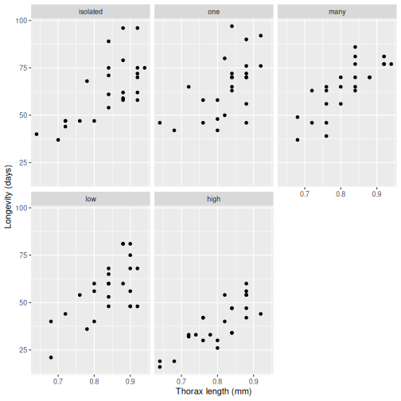
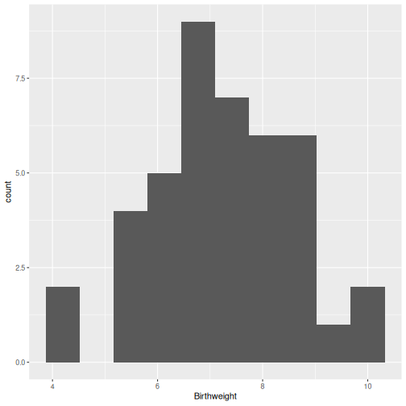
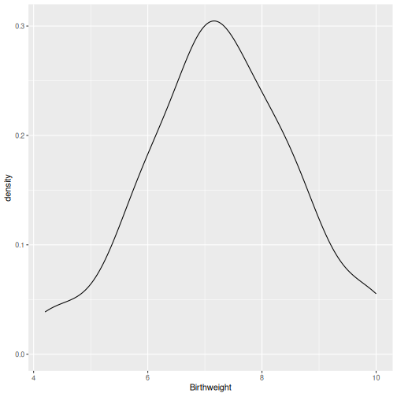
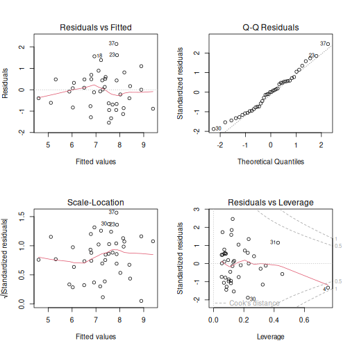
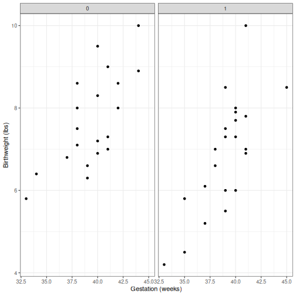

*This chapter follows the Topic 6 workshop material and includes the worked
solutions at the end so that you can attempt each task before checking it.*

:::{important}
Complete [Topic 5 Part II: Linear Regression](topic-5-linear-regression.md)
before starting this chapter. Topic 6 extends the same `lm()` workflow to
models with more than one explanatory variable, interactions, and model
selection.
:::

## Files for Topic 6

Create a `LIFE707/Topic_6` folder and download the files before starting.
They are included with this book, so you do not need to return to Canvas.

- <a href="/data/topic-6-multiple-regression/fruitfly.txt?download=1">Fruitfly data (fruitfly.txt)</a>
- <a href="/data/topic-6-multiple-regression/hydrolase.txt?download=1">Hydrolase data (hydrolase.txt)</a>
- <a href="/data/topic-6-multiple-regression/birthweight.csv?download=1">Birthweight data (birthweight.csv)</a>
- <a href="/data/topic-6-multiple-regression/haemoglobin.csv?download=1">Haemoglobin data (haemoglobin.csv)</a>
- <a href="/data/topic-6-multiple-regression/antid1.txt?download=1">Antidepressant reference data (antid1.txt)</a>

When running the code, place the downloaded data files in the same working
folder as your R script, or update the file paths in the code.

## Introduction

Watch the following video before working through the workshop material. It
introduces the multiple-regression workflow used in this chapter.

<div style="position: relative; width: 100%; height: 0; padding-bottom: 56.25%; margin-bottom: 2rem;">
  <iframe src="https://liverpool.cloud.panopto.eu/Panopto/Pages/Embed.aspx?id=1b8851af-9764-4b6b-87a6-b4ff00cb0279&amp;autoplay=false&amp;offerviewer=true&amp;showtitle=true&amp;showbrand=true&amp;captions=true&amp;interactivity=all" style="border: 1px solid #464646; position: absolute; top: 0; left: 0; width: 100%; height: 100%; box-sizing: border-box;" allowfullscreen allow="autoplay" aria-label="Panopto Embedded Video Player" aria-description="Topic 6 multiple regression introduction"></iframe>
</div>

## Workshop material

Go through the examples here. Tasks for you to do yourself are indicated, and are supported by answers and videos on Canvas, but please try for yourself first.

## Two explanatory variables

### *Drosophila* example

Let's look at a regression example taken and edited from Faraway, (2004), p 174.

This involves a classic experiment from Linda Partridge's lab on the cost of mating in the fly *Drosophila melanogaster*. Each sampling point consisted of a male fly for which the researchers measured longevity, as a potential cost of mating, and thorax length (in mm), which they knew to be important and which they wished to control for.

The experimental procedures were as follows. Each male was allocated to one of five treatment groups, that is they were put into a vial containing: (i) a male by itself - 'isolated', (ii) one pregnant female, - 'one', (iii) eight pregnant females - 'many', (iv) one virgin female - 'low', or (v) eight virgin females - 'high'.

The hypothesis tested is that mating reduces longevity of males. Thus, males will mate with virgin females but not pregnant females, so the 'one' and 'many' groups act as controls for the 'low' and 'high' groups, respectively.

The reason for using multiple regression, though, is that the size of a fly also affects how long it lives. Multiple regression allows us to control for the size of a fly and to test their experiment treatments.

Read in the fruitfly.txt file to a dataframe object called `fruitfly`.

```r
fruitfly <- read.table("fruitfly.txt",header=TRUE)
```

Remind yourself how to read in data from the previous topics if needed. The first few lines should look like:

```r
head(fruitfly)
```

:::{dropdown} Show expected output
```text
##   thorax longevity activity
## 1   0.68        37     many
## 2   0.68        49     many
## 3   0.72        46     many
## 4   0.72        63     many
## 5   0.76        39     many
## 6   0.76        46     many
```
:::

Activity contains the 5 different treatment groups above. We can see this with the `table` command

```r
table(fruitfly$activity)
```

:::{dropdown} Show expected output
```text
## 
##     high isolated      low     many      one 
##       25       25       25       24       25
```
:::

However, when the data are first read into R, activity is read in as a character string. To explicitly specify the column activity to be a factor, we can use

```r
fruitfly$activity <- factor(fruitfly$activity, levels = c("isolated","one","many","low","high"))
```

Here I've used the `levels` argument to put the treatment groups into an order that makes some sense based on the experiment (otherwise they would be read in alphabetically).

Let's get a feel for the data by plotting it out. This is similar to some of the examples we plotted in Topic 2 using`ggplot`. We have thorax length and longevity, which are both continuous variables, in each of their 5 treatment groups. Longevity is the response variable (y variable) and we're interested in how thorax length and treatment (the explanatory variables) affect this.

```r
fly.plot1 <- ggplot(data=fruitfly, aes(x=thorax, y=longevity))

#produce a scatterplot for each treatment level
fly.plot1 + geom_point() +
  xlab("Thorax length (mm)") + ylab("Longevity (days)") +
  facet_wrap(~activity)
```



From looking at this, we probably see two patterns. The first is that bigger flies live longer. The second is that male flies in the high treatment group (having sex with lots virgin females) seem to have shorter lives. We next test these ideas formally using multiple regression.

### Fitting a model

From the video, recall that the multiple regression equation is simply:

$$y = \alpha + \beta_{1} x_{1} + \beta_{2} x_{2} + ... + e$$

In R, we can still use the `lm` function and just put a formula in the form of `y ~ x1 + x2`.

Let's fit a model that has both thorax length and activity.

```r
ff1 <- lm(longevity ~ thorax + activity, data = fruitfly)
summary(ff1)
```

:::{dropdown} Show expected output
```text
## 
## Call:
## lm(formula = longevity ~ thorax + activity, data = fruitfly)
## 
## Residuals:
##     Min      1Q  Median      3Q     Max 
## -26.108  -7.014  -1.101   6.234  30.265 
## 
## Coefficients:
##              Estimate Std. Error t value Pr(>|t|)    
## (Intercept)   -48.749     10.850  -4.493 1.65e-05 ***
## thorax        134.341     12.731  10.552  < 2e-16 ***
## activityone     2.637      2.984   0.884   0.3786    
## activitymany    4.139      3.027   1.367   0.1741    
## activitylow    -7.015      2.981  -2.353   0.0203 *  
## activityhigh  -20.004      3.016  -6.632 1.05e-09 ***
## ---
## Signif. codes:  0 '***' 0.001 '**' 0.01 '*' 0.05 '.' 0.1 ' ' 1
## 
## Residual standard error: 10.54 on 118 degrees of freedom
## Multiple R-squared:  0.6527, Adjusted R-squared:  0.638 
## F-statistic: 44.36 on 5 and 118 DF,  p-value: < 2.2e-16
```
:::

Here we've fitted two terms, thorax and activity, but have fitted 5 coefficients plus the intercept. The reason is that activity is a 5-level factor. The way we've set it up, the first level is 'isolated', i.e. a male by itself. The other 4 levels are compared against this 'isolated' level.

From the table above, we can see that the coefficient for thorax is positive; bigger flies live longer. We also see a significant, negative coefficient for the 'low' activity level and an even bigger negative coefficient for the 'high' activity level; this suggests that males put in a vial with a virgin female have a bit of a shorter life (by about 7 days) and a much shorter life if in a vial with 8 virgin females (by about 20 days). There is no evidence that putting males in with pregnant females shortens their life (the coefficients don't appear significant). Therefore sex reduces male lifespan and the more sex they have the shorter their lives are. (As a caveat, we'll discuss in a later topic that there are better ways of testing significance of coefficients than looking at the summary table, particularly in observational studies where variables often covary.)

### Exercise 1: Fruitfly predictions

What is the expected lifespan of flies in the 'low' activity group and with thorax lengths of 0.75 and 0.85mm?

The lifespan of flies in the 'high' activity group with thorax lengths of 0.75 and 0.85mm?

The lifespan of flies in the 'isolated' activity group with thorax lengths of 0.75 and 0.85mm?

You'll need to look at the coefficients produced from the model and calculate a prediction. You can check you're in the right ballpark by looking at the plot above.


### Interactions

So far, we've assumed that thorax length and treatment act independently. We can also fit a more complex model with interactions. An interaction in this case would assume that there are different slopes for longevity versus thorax for each treatment. An interaction here might mean something like 'sex reduces longevity, but only in small flies', which could be biologically plausible and is worth checking.

We can specify this more complex model with the formula `longevity ~ thorax * activity`. The `*` part of the formula expands all combinations of thorax and activity to include the interactions and can also be written as `longevity ~ thorax + activity + thorax:activity`.

```r
ff2 <- lm(longevity ~ thorax * activity, data = fruitfly)
summary(ff2)
```

:::{dropdown} Show expected output
```text
## 
## Call:
## lm(formula = longevity ~ thorax * activity, data = fruitfly)
## 
## Residuals:
##      Min       1Q   Median       3Q      Max 
## -25.9509  -6.7296  -0.9103   6.1854  30.3071 
## 
## Coefficients:
##                     Estimate Std. Error t value Pr(>|t|)    
## (Intercept)         -50.2420    21.8012  -2.305    0.023 *  
## thorax              136.1268    25.9517   5.245 7.27e-07 ***
## activityone           6.5172    33.8708   0.192    0.848    
## activitymany         -1.1394    32.5298  -0.035    0.972    
## activitylow          -7.7501    33.9690  -0.228    0.820    
## activityhigh        -11.0380    31.2866  -0.353    0.725    
## thorax:activityone   -4.6771    40.6518  -0.115    0.909    
## thorax:activitymany   6.5478    39.3600   0.166    0.868    
## thorax:activitylow    0.8743    40.4253   0.022    0.983    
## thorax:activityhigh -11.1268    38.1200  -0.292    0.771    
## ---
## Signif. codes:  0 '***' 0.001 '**' 0.01 '*' 0.05 '.' 0.1 ' ' 1
## 
## Residual standard error: 10.71 on 114 degrees of freedom
## Multiple R-squared:  0.6534, Adjusted R-squared:  0.626 
## F-statistic: 23.88 on 9 and 114 DF,  p-value: < 2.2e-16
```
:::

Terms like 'thorax:activityone' refer to the coefficient the model fits to thorax in the 'one' treatment group. Although some of the coefficients for these interactions are quite large, so are their standard errors and so `summary` suggests none are significant.

A more robust way to ask the question of whether the interactions are significant is to ask whether a model containing the interactions provides a significantly better fit of the data than a model that doesn't have the interactions. Thus, we've created a model `ff2`, which contains the interactions and the model `ff1`, which doesn't. Since the only explanatory terms that differ between the models are the interaction terms, comparing `ff2` versus `ff1` should give the significance of those interaction terms.

We can compare the fit of the two models, using either the `anova` or `drop1` commands. With `anova` you explicitly tell R the pair of models that you want to compare. `drop1` assumes that you want to compare a pair of 'nested' models, i.e. compare the model you give to a simpler model from which the interaction term has been 'dropped'. To get a p-value for linear models we use an *F*-test, hence the `test="F"` argument.

```r
anova(ff2, ff1, test="F")

```

:::{dropdown} Show expected output
```text
## Analysis of Variance Table
## 
## Model 1: longevity ~ thorax * activity
## Model 2: longevity ~ thorax + activity
##   Res.Df   RSS Df Sum of Sq     F Pr(>F)
## 1    114 13083                          
## 2    118 13107 -4   -24.314 0.053 0.9947
```
:::

```r
drop1(ff2, test="F")

```

:::{dropdown} Show expected output
```text
## Single term deletions
## 
## Model:
## longevity ~ thorax * activity
##                 Df Sum of Sq   RSS    AIC F value Pr(>F)
##                        13083 597.69               
## thorax:activity  4    24.314 13107 589.92   0.053 0.9947
```
:::

In both cases it gives the p-value (0.99, not significant), based on an *F*-test with 4 and 114 degrees of freedom (*F*~4,114~=0.053). Although there are 5 levels, the 'isolated' level is subsumed into the intercept, so that the 'one', 'many', 'low' and 'high' levels are contrasted against the 'isolated' level. We will go through model selection and testing coefficients in more detail later.

You also use `drop1` on the simpler ff1 model:

```r
drop1(ff1, test="F")
```

:::{dropdown} Show expected output
```text
## Single term deletions
## 
## Model:
## longevity ~ thorax + activity
##          Df Sum of Sq   RSS    AIC F value    Pr(>F)    
##                 13107 589.92                      
## thorax    1   12368.4 25476 670.32 111.348 < 2.2e-16 ***
## activity  4    9634.6 22742 650.25  21.684 1.974e-13 ***
## ---
## Signif. codes:  0 '***' 0.001 '**' 0.01 '*' 0.05 '.' 0.1 ' ' 1
```
:::

Here you get significant levels for each of the two main effects, thorax and activity. Thorax is a simple continuous variable, hence it has one degree of freedom associated with it. Activity is a 5 level factor, and as we saw above needs 4 coefficients fitted, hence it has 4 degrees of freedom. For both thorax and activity P\<0.001.

### Exercise 2: Hydrolase slopes

Glycoside hydrolases able to metabolise starch were isolated from two different species of bacteria (A and B) and their activity in enzyme units (U or µmol/min) measured across a range of salt concentrations (percentage NaCl w/v). The data are within the file hydrolase.txt

First plot out hydrolase activity vs salt concentration from the 2 species. Do these appear to have the same or different slopes in the two species?

Perform an analyse to determine whether the slopes are statistically different.


## Model selection

Watch the following video before progressing through the Model selection material. Pause here and watch it before continuing with the workshop.

<div style="position: relative; width: 100%; height: 0; padding-bottom: 56.25%; margin-bottom: 2rem;">
  <iframe src="https://liverpool.cloud.panopto.eu/Panopto/Pages/Embed.aspx?id=a9d92d04-f639-4cc2-8bcf-b4ff00cac80e&amp;autoplay=false&amp;offerviewer=true&amp;showtitle=true&amp;showbrand=true&amp;captions=true&amp;interactivity=all" style="border: 1px solid #464646; position: absolute; top: 0; left: 0; width: 100%; height: 100%; box-sizing: border-box;" allowfullscreen allow="autoplay" aria-label="Panopto Embedded Video Player" aria-description="Topic 6 model selection"></iframe>
</div>

A common problem, particularly in observational studies, is that you want to explain a particular trait given a lot of potential explanatory variables that you've measured. You want to able to say which explanatory variables are associated with the trait and which aren't. You may therefore want a model that (a) tells you what the important biology is and (b) predicts the value of the trait that you're interested in.

### What makes a good model?

-   A general problem that statistical modeling addresses is to extract the main biological features from a set of, often complex, data.

-   Quite often one has a lot of potential explanatory variables that could influence the dependent variable one is interested in, but not all of them do, or at least not to any great extent.

-   The trick is to determine which explanatory variables have a 'significant' effect and quantify the size of that effect.

### Some points to consider

A 'significant' effect can either mean statistical significance, i.e. a p-value. Or it can mean biological significance. For example, given a large enough data set,one might be able to find effects that are statistically significant effects but that still have very little influence on the dependent variable compared to some other, more major, effects.

All models are wrong. In other words, all models are a representation of the data, and so are not in any sense 'true'. Any model is just one of many possible models; the process of model selection just tries to pick a model that's less wrong than other such models.

Statistical models are merely tools to help you interpret patterns and test hypotheses. While one can generate these models in a systematic and sensible way, it's important to recognise the limitations of a statistical model and not confuse it with reality. This has sometimes been phrased as, 'don't fall in love with your model'.

Be careful to try to distinguish what may be causality from association, particularly in observational studies. Think critically about how to interpret the results of the model.

### Model simplification

The basic philosophy is to follow [Occam's Razor](https://en.wikipedia.org/wiki/Occam%27s_razor); if you have two models, each with the same predictive power, you should prefer the simpler model.

We'll principally use a method called deletion testing (sometimes called backwards selection) in order to select a model that is useful; i.e. one that has informative biological inference, but is not too complicated that we can't make any inference. Deletion testing begins by taking a complex model and tries to make that model simpler by successively removing non-significant terms. It's dealt with well by in Crawley's books (e.g. Crawley, M.J.(2005) Statistics: An introduction using R.). In the table below, the aim is to get from the maximal model to the minimal adequate model.

Table 1. Definition of statistical models referred to in deletion testing.


### The process of deletion testing

A flow diagram of the process of deletion testing, as suggested by Crawley, is shown in Figure 1. (Other methods have been proposed, e.g. using `step`, but the process below is a bit more stringent and less likely to retain terms that are not significant.)


Figure 1. Flow diagram of model selection process.

We've essentially done this already in the fruitfly example, but let's see the process using a slightly complex example.

### Birthweight

The file birthweight.csv contains data on birthweight plus various factors associated with the mother or the pregnancy for 42 babies. Read these data in.

```r
birthweight <- read.csv("birthweight.csv",header=TRUE)
```

It contains the following variables:

-   *ID* Baby number

-   *length* Length of baby (inches)

-   *Birthweight* Weight of baby (lbs)

-   *headcirumference* Head Circumference

-   *Gestation* Gestation (weeks)

-   *smoker* Mother smokes 1 = smoker 0 = non-smoker

-   *motherage* Maternal age

-   *mnocig* Number of cigarettes smoked per day by mother

-   *mheight* Mothers height (inches)

-   *mppwt* Mothers pre-pregnancy weight (lbs)

-   *fage* Father's age

-   *fedyrs* Father’s years in education

-   *fnocig* Number of cigarettes smoked per day by father

-   *fheight* Father's height (inches)

-   *lowbwt* Low birth weight, 0 = No and 1 = yes

-   *mage35* Mother over 35, 0 = No and 1 = yes

```r
summary(birthweight)
```

:::{dropdown} Show expected output
```text
##        id         headcirumference     length       Birthweight    
##  Min.   :  27.0   Min.   :12.00    Min.   :17.00   Min.   : 4.200  
##  1st Qu.: 537.2   1st Qu.:13.00    1st Qu.:19.00   1st Qu.: 6.450  
##  Median : 821.0   Median :13.00    Median :20.00   Median : 7.250  
##  Mean   : 894.1   Mean   :13.26    Mean   :19.93   Mean   : 7.264  
##  3rd Qu.:1269.5   3rd Qu.:14.00    3rd Qu.:21.00   3rd Qu.: 8.000  
##  Max.   :1764.0   Max.   :15.00    Max.   :22.00   Max.   :10.000  
##    Gestation         smoker         motherage         mnocig      
##  Min.   :33.00   Min.   :0.0000   Min.   :18.00   Min.   : 0.000  
##  1st Qu.:38.00   1st Qu.:0.0000   1st Qu.:20.25   1st Qu.: 0.000  
##  Median :39.50   Median :1.0000   Median :24.00   Median : 4.500  
##  Mean   :39.19   Mean   :0.5238   Mean   :25.55   Mean   : 9.429  
##  3rd Qu.:41.00   3rd Qu.:1.0000   3rd Qu.:29.00   3rd Qu.:15.750  
##  Max.   :45.00   Max.   :1.0000   Max.   :41.00   Max.   :50.000  
##     mheight         mppwt            fage          fedyrs          fnocig     
##  Min.   :58.0   Min.   : 99.0   Min.   :19.0   Min.   :10.00   Min.   : 0.00  
##  1st Qu.:63.0   1st Qu.:115.0   1st Qu.:23.0   1st Qu.:12.00   1st Qu.: 0.00  
##  Median :64.0   Median :125.0   Median :29.5   Median :14.00   Median :18.50  
##  Mean   :64.4   Mean   :125.9   Mean   :28.9   Mean   :13.67   Mean   :17.19  
##  3rd Qu.:66.0   3rd Qu.:135.0   3rd Qu.:32.0   3rd Qu.:16.00   3rd Qu.:25.00  
##  Max.   :71.0   Max.   :170.0   Max.   :46.0   Max.   :16.00   Max.   :50.00  
##     fheight          lowbwt           mage35       
##  Min.   :66.00   Min.   :0.0000   Min.   :0.00000  
##  1st Qu.:69.00   1st Qu.:0.0000   1st Qu.:0.00000  
##  Median :71.00   Median :0.0000   Median :0.00000  
##  Mean   :70.76   Mean   :0.1429   Mean   :0.09524  
##  3rd Qu.:72.00   3rd Qu.:0.0000   3rd Qu.:0.00000  
##  Max.   :78.00   Max.   :1.0000   Max.   :1.00000
```
:::

We won't analyse all of these here. Let's say that we're interested in birthweight and if or how it might be affected by 3 explanatory variables -- gestation, mother's age and smoking.

It's good practice to consider whether the response variable in particular is normally distributed or not. This is a fairly small data set, so the histogram doesn't look particularly smooth, but we can probably accept that it's a continuous variable with a mean somewhere roughly in the middle of its distribution.

```r
p.bw <- ggplot(data=birthweight,aes(x=Birthweight))
p.bw + geom_histogram(bins=10)
p.bw + geom_density()
```





The next decision is what maximal model to start with. This decision introduces an arbitrary nature to the process, because where you start the deletion testing process may affect what model you arrive at. In fact, deciding what variables to measure in the study is also somewhat arbitrary. Bear in mind two things that we said above: that we're trying to get an understanding of the system, not necessarily produce the best statistical model we can and; second, that there may not be single right 'correct' model, but one that is useful.

Smoking is probably important but it is coded in two ways. Whether a mother smokes or not, and how many cigarettes she smokes. How many cigarettes she smokes is therefore a strange variable because a lot of mothers smoke zero cigarettes. Fitting a coefficient to this might not cope well with its obviously non-normal distribution. It may be simpler to just consider the binary variable of whether a mother smokes or not (the variable 'smoker'). You can, if you like, investigate the distribution of the explanatory variables for smoking, gestation and mother's age.

We can now define a maximal model containing the variables 'Gestation', 'motherage' and 'smoker'. We also need to include the interactions between them. In the model formula, the specification `(Gestation + smoker + motherage)^2` is a simple way to say we want the 3 main effects of each variable plus all possible 2-way interactions between them; i.e. it's equivalent to `Gestation + smoker + motherage + Gestation:smoker + Gestation:motherage + smoker:motherage`. Of course this looks complicated; this is the point of a maximal model. We create this complicated model in order to systematically simplify it and discover what's important.

```r
mod.max1 <- lm(Birthweight ~ (Gestation + smoker + motherage)^2, data = birthweight)
summary(mod.max1)

```

:::{dropdown} Show expected output
```text
## 
## Call:
## lm(formula = Birthweight ~ (Gestation + smoker + motherage)^2, 
##     data = birthweight)
## 
## Residuals:
##      Min       1Q   Median       3Q      Max 
## -1.54253 -0.68811  0.00729  0.49185  2.14169 
## 
## Coefficients:
##                     Estimate Std. Error t value Pr(>|t|)
## (Intercept)          3.38026   11.20615   0.302    0.765
## Gestation            0.11415    0.27778   0.411    0.684
## smoker              -5.51067    4.76083  -1.158    0.255
## motherage           -0.28456    0.45146  -0.630    0.533
## Gestation:smoker     0.10410    0.11865   0.877    0.386
## Gestation:motherage  0.00703    0.01128   0.623    0.537
## smoker:motherage     0.02886    0.06168   0.468    0.643
## 
## Residual standard error: 0.9323 on 35 degrees of freedom
## Multiple R-squared:  0.5803, Adjusted R-squared:  0.5084 
## F-statistic: 8.067 on 6 and 35 DF,  p-value: 1.652e-05
```
:::

It's probably also sensible to check that there aren't any glaring problems with the model by running `plot(mod.max1)`.

```r
par(mfrow=c(2,2))
plot(mod.max1)
par(mfrow=c(1,1))
```



There's nothing here I'd worry about, especially given we have a fairly low number of data points, so let's proceed with model simplification. Use `drop1` to start to test the terms in the maximal model.

```r
drop1(mod.max1, test="F")
```

:::{dropdown} Show expected output
```text
## Single term deletions
## 
## Model:
## Birthweight ~ (Gestation + smoker + motherage)^2
##                     Df Sum of Sq    RSS      AIC F value Pr(>F)
##                            30.423  0.45671               
## Gestation:smoker     1   0.66912 31.093 -0.62957  0.7698 0.3863
## Gestation:motherage  1   0.33779 30.761 -1.07954  0.3886 0.5371
## smoker:motherage     1   0.19036 30.614 -1.28131  0.2190 0.6427
```
:::

Here you see the specification of the maximal model followed by the significance of each successive term tested by `drop1`. `drop1` tests each term in turn by dropping it from the model and seeing what impact it has in explanatory power, judged by an *F* test. The rule followed by `drop1` is that it will drop interaction terms, but not lower order terms that are contained by an interaction term present in the model. For example, `drop1` tests the interaction term smoker:motherage but does not test (drop) the main effects smoker and motherage since these are contained within the interaction term.

One can also see what `drop1` does by the more manual method:

```r
tmp <- update(mod.max1, .~. - smoker:motherage) 
anova(mod.max1,tmp,test="F")
```

:::{dropdown} Show expected output
```text
## Analysis of Variance Table
## 
## Model 1: Birthweight ~ (Gestation + smoker + motherage)^2
## Model 2: Birthweight ~ Gestation + smoker + motherage + Gestation:smoker + 
##     Gestation:motherage
##   Res.Df    RSS Df Sum of Sq     F Pr(>F)
## 1     35 30.423                          
## 2     36 30.614 -1  -0.19036 0.219 0.6427
```
:::

`update` here looks at the object mod.max1 and produces a new model based on its formula (`.~.`) minus the term smoker:motherage and creates a new object tmp. (I often name objects 'tmp' that I'm not going to keep for long.). `anova(model1, model2, test="F")` compares two nested models (i.e. models that only differ by a single term) and performs an *F* test on them. You can see the p-value and F-value are equivalent to the last line from `drop1` above.

Consider again the result from

```r
drop1(mod.max1, test="F")
```

:::{dropdown} Show expected output
```text
## Single term deletions
## 
## Model:
## Birthweight ~ (Gestation + smoker + motherage)^2
##                     Df Sum of Sq    RSS      AIC F value Pr(>F)
##                            30.423  0.45671               
## Gestation:smoker     1   0.66912 31.093 -0.62957  0.7698 0.3863
## Gestation:motherage  1   0.33779 30.761 -1.07954  0.3886 0.5371
## smoker:motherage     1   0.19036 30.614 -1.28131  0.2190 0.6427
```
:::

Are there any terms where p \> 0.05. If so, which is *least* significant term above? This is the term with the highest p-value (and lowest F value), smoker:motherage. The `update` function above shows how to delete a single term. So we can delete smoker:motherage (p=0.64) and try `drop1` again. (The model simplification will see us generating successively simpler models using `update`, which I'm going to call m1.1, m1.2, etc.)

```r
m1.1 <- update(mod.max1, .~. - smoker:motherage)
drop1(m1.1, test= "F")
```

:::{dropdown} Show expected output
```text
## Single term deletions
## 
## Model:
## Birthweight ~ Gestation + smoker + motherage + Gestation:smoker + 
##     Gestation:motherage
##                     Df Sum of Sq    RSS     AIC F value Pr(>F)
##                            30.614 -1.2813               
## Gestation:smoker     1   0.73568 31.349 -2.2839  0.8651 0.3585
## Gestation:motherage  1   0.20450 30.818 -3.0017  0.2405 0.6268
```
:::

So Gestation:motherage is both insignificant and the least significant. So we repeat this process. It is important to only drop one term at a time, since during the process something that previously didn't seem significant can become significant in a simpler model.

Remember as you go along to change the model you're updating to the model you created in the previous step. It's easy to make mistakes, so take your time...

```r
m1.2 <- update(m1.1, .~. - Gestation:motherage)
drop1(m1.2, test= "F")

```

:::{dropdown} Show expected output
```text
## Single term deletions
## 
## Model:
## Birthweight ~ Gestation + smoker + motherage + Gestation:smoker
##                  Df Sum of Sq    RSS     AIC F value Pr(>F)
##                         30.818 -3.0017               
## motherage         1   0.03321 30.851 -4.9564  0.0399 0.8428
## Gestation:smoker  1   1.07041 31.889 -3.5676  1.2851 0.2642
```
:::

Now repeat this process yourself. The next term you should drop is motherage. Although it is a main effect, it is not part of the Gestation:smoker interaction. Carry on until no further terms can be dropped.

```r
m1.3 <- update(m1.2, .~. - motherage)
#drop1(m1.3, test= "F")
m1.4 <- update(m1.3, .~. - Gestation:smoker)
#drop1(m1.4, test= "F")
```

Now run `drop1` and `summary` on your final model (the minimal adequate model). You should get something like:

```r
drop1(m1.4, test= "F")
summary(m1.4)
```

What this says is that both Gestation and whether a mother smokes are significant terms affecting birthweight. But there is no interaction between the two. From the sign of the coefficients in the summary table, birthweight increases with gestation time and birthweight is reduced in mothers who smoke. To see this, we can put what we learnt in data visualisation to good use. There's a really strong effect of gestation time on birth weight. From the plot (and the positive coefficient for Gestation in the minimal model) we see that babies born later are heavier. There's also a noticeable effect of smoking. The coefficient in the model is negative, indicating that babies are born lighter to mothers who smoke.

```r
#what to plot
bw.plot1 <- ggplot(data=birthweight, aes(x=Gestation,y=Birthweight))

#how to plot it, Birthweight vs Gestation, split by smoker or not
bw.plot1 + geom_point() + facet_wrap(~smoker) +
  xlab("Gestation (weeks)") + ylab("Birthweight (lbs)") +
  theme_bw() 
```



### Exercise 3: Birthweight model selection

Generate a minimal adequate model from the following maximal model

`lm(Birthweight ~ (Gestation + smoker + mppwt)^2, data = birthweight)`

Comment on the importance of mother's prepregnancy weight (mppwt).


### Exercise 4: Haemoglobin model selection

The file haemoglobin.csv contains data on haemoglobin levels in the blood from alpha thalasaemia carriers and normal controls (neither have disease symptoms).\

-   sex; male/female

-   phenotype; alpha_carrier/normal

-   pcv; packed cell volume (percentage)

-   rbc; red blood cell count (10^12^/L)

-   lymph; white blood cell count (10^6^/L)

-   hb; haemoglobin concentration (g/dL)

Using hb as the response variable explore which, if any, of the other variables is associated with haemoglobin concentration. Produce a table of your model and a plot of your results and briefly comment on the biological interpretation.


## Workshop Walkthrough Video

<div style="position: relative; width: 100%; height: 0; padding-bottom: 56.25%; margin-bottom: 2rem;">
  <iframe src="https://liverpool.cloud.panopto.eu/Panopto/Pages/Embed.aspx?id=b635660c-99f4-4040-a592-b4ff00cac80c&amp;autoplay=false&amp;offerviewer=true&amp;showtitle=true&amp;showbrand=true&amp;captions=true&amp;interactivity=all" style="border: 1px solid #464646; position: absolute; top: 0; left: 0; width: 100%; height: 100%; box-sizing: border-box;" allowfullscreen allow="autoplay" aria-label="Panopto Embedded Video Player" aria-description="Topic 6 code run through"></iframe>
</div>

## Exercise solutions

The solutions below are provided for checking your work after attempting the
tasks in the workshop material.

### Exercise 1: Fruitfly predictions

The numbered code block contains the model summary used for the calculations below; the relevant coefficients are on lines 1–2.

Look again at the model.

```{code-block} r
:linenos:
summary(ff1)
```

Let's manually work out the longevity of these flies. Predicted longevity = intercept + thorax length \* fitted coefficient for slope + low activity coefficient.

*Thus, in the low activity group with size of 0.75mm*

Predicted longevity = -48.749 + 134.341 \* 0.75 -7.015 = 44.99 days

Check this looks sensible on the plot. If you've got the calculation badly wrong you'll see it.

*The low activity group with size of 0.85mm*

Predicted longevity = -48.749 + 134.341 \* 0.85 -7.015 = 58.43 days

*The high activity group with size of 0.75mm*

Predicted longevity = -48.749 + 134.341 \* 0.75 -20.004 = 32.00 days

*The high activity group with size of 0.85mm*

Predicted longevity = -48.749 + 134.341 \* 0.85 -20.004 = 45.44 days

Some of you may be wondering were the isolated treatment group is in the table. The other 4 treatment groups are compared against the isolated group, so it's in the intercept.

*The isolated activity group with size of 0.75mm*

Predicted longevity = -48.749 + 134.341 \* 0.75 = 52.01 days

*The isolated activity group with size of 0.85mm*

Predicted longevity = -48.749 + 134.341 \* 0.85 = 65.44 days

### Exercise 2: Hydrolase slopes

The numbered block follows the workflow described below: lines 1–2 read and inspect the data, lines 4–5 define the factor, lines 7–10 make the plot, lines 12–15 fit and test the interaction, and lines 17–19 check diagnostics.

```{code-block} r
:linenos:
hydrolase <- read.table("hydrolase.txt",header=TRUE)
head(hydrolase)

hydrolase$species <- factor(hydrolase$species, levels=c("A","B")) 
#levels argument redundant, since levels are assigned alphabetically, but good practice

hydro.plot1 <- ggplot(data=hydrolase, aes(x=salt, y=activity))

hydro.plot1 + geom_point() + 
  facet_wrap(~species) + 
  xlab("Salt concentration (w/v)") + ylab("Hydrolase activity (U)")

hydro.mod <- lm(activity ~ species*salt,data=hydrolase)
summary(hydro.mod)

drop1(hydro.mod,test="F")

par(mfrow=c(2,2))
plot(hydro.mod)
par(mfrow=c(1,1))
```

Lines 1–2 read the file and inspect its first rows.

Lines 4–5 define `species` as a factor.

Lines 7–10 produce the plot used to compare the two species.

The plot from lines 7–10 suggests that the slopes differ, so an interaction is plausible.

Lines 12–15 fit the model and test the interaction; `drop1` tests the interaction term rather than the main effects.

The output from lines 13–15 confirms the interaction suggested by the plot.

Lines 17–19 check the model diagnostics. This plot is for checking the model, rather than for including in a report.

### Exercise 3: Birthweight model selection

The numbered block follows the model-selection sequence: lines 1–2 load the data, lines 4–5 fit the maximal model, and the later lines perform deletion testing, prediction checks, and plotting.

```{code-block} r
:linenos:
birthweight <- read.csv("birthweight.csv",header=TRUE)

bw.max <- lm(Birthweight ~ (Gestation + smoker + mppwt)^2, data = birthweight)

drop1(bw.max, test="F")

bw.mod.1 <- update(bw.max, .~. - Gestation:mppwt)

drop1(bw.mod.1, test="F")

bw.mod.2 <- update(bw.mod.1, .~. - Gestation:smoker)
drop1(bw.mod.2, test="F")

bw.mod.3 <- update(bw.mod.2, .~. - smoker:mppwt)
drop1(bw.mod.3, test="F")

summary(bw.mod.3)

par(mfrow=c(2,2))
plot(bw.mod.3)
par(mfrow=c(1,1))

#starting again from the maximal model
bw.step.1 <- step(bw.max)
drop1(bw.step.1, test ="F") # still has smoker:mppwt

bw.step.2 <- update(bw.step.1, .~. - smoker:mppwt)
drop1(bw.step.2, test="F")

summary(birthweight$Gestation)

summary(birthweight$mppwt)

#what to plot
bw.plot2 <- ggplot(data = birthweight, aes(x=Gestation, y=Birthweight, color=mppwt))

#how to plot it (this is just the code from the workshop)
bw.plot2 + geom_point(size=4) + facet_wrap(~smoker) +
  xlab("Gestation (weeks)") + ylab("Birthweight (lbs)") +
  theme_bw() +scale_color_gradient(low="blue", high="red")
```

Lines 4–5 start with the maximal model.

Lines 7–8 test which term should be dropped first.

None of terms is significant, but Gestation:mppwt is the least significant so we drop this first. We can do this with the `update` function.

Lines 10–11 test the updated model again.

Next term to drop is Gestation:smoker. Take your time to keep track of each model name and term to be dropped. It's easy to make mistakes during this.

smoker:mppwt isn't quite significant. Drop it.

By lines 13–16, all remaining terms are significant, so we have reached the minimal model.

We can check what it looks like with `summary(bw.mod.3)` and `plot(bw.mod.3)`:

This is relatively OK given we have a fairly small number of data points.

------------------------------------------------------------------------

### Alternate approach

You can also use the `step` function to cut out some of the steps, but it will keep the smoker:mppwt and has to be nudged along from there.

This gets us to the same minimal adequate model as before.

> Comment on the importance of mother's prepregnancy weight (mppwt).

From the model, mppwt (mother's weight) is statistically significant at the 5% level but not the 1% level. This is one measure of 'significance'. But biological significance might also be considered if you want to ask how 'important' is mother's weight for birth weight. One way to do this is to predict from the model what weight of baby we expect from two mothers of different weights. The summary of the model (`summary(bw.mod.3)`) give us the formula of the model:

`birthweight ~ -7.165 + 0.313*Gestation (weeks) -0.665*smoker + 0.0198*mppwt`

We just need to find some sensible values to plus into the model.

First, what's a typical gestation time?

Let's take the median gestation time of 39.5 weeks.

Second, what are sensible weights to give the model for a 'light' mother and a 'heavy' mother?

Using the interquartile range we could use a value for a 'light' mother as 115lbs and a 'heavy' mother as 135lbs. The language of 'light' and 'heavy' is problematic and comes with some social baggage. By picking the interquartile range (containing half of the women in the study), these are women who are both within the typical range of weights, but just a bit lighter than average or a bit heavier than average.

Let's make things a bit easier by predicting birth weight from non-smokers, since that term will go to zero in the model (`-0.665*0 = 0`). So for intercept + gestation + mother's age:

A 115 lb mother giving birth at 39.5 weeks could expect a baby of

-7.165 + 0.313 \* 39.5 + 0.0198 \* 115 = 7.48 lbs

A 135 lb mother giving birth at 39 weeks could expect a baby of

-7.165 + 0.313 \* 39.5 + 0.0198 \* 135 = 7.87 lbs

So there's some difference (\~0.4 lbs), but not huge.

The same approach for gestation time, taking the median for mother's weight and the interquartile range for gestation time as 38 - 41 weeks, gives a bigger difference (nearly 1 lb). It's more obvious biological effect that the longer a baby grows inside mum the bigger it gets when it finally comes out.

-7.165 + 0.313 \* 38 + 0.0198 \* 125 = 7.20 lbs

-7.165 + 0.313 \* 41 + 0.0198 \* 125 = 8.14 lbs

(You can also investigate `predict.lm`, which can take a data frame of dummy values without having to manually do the prediction.)

Some of you have probably tried plotting the model, which is the challenge of plotting Birthweight \~ Gestation + mppwt + smoker, i.e. how is birthweight affected by gestation time and mother's weight and whether she's a smoker or not. I struggled to come up with a very convincing plot, largely because the effect of mother's weight is fairly small. In the material, we saw how to use `ggplot` to visualise Birthweight \~ Gestation + smoker so now we need to work out how to add mppwt to this. One way, which uses code that you've (mostly) already learnt, is to use colour for mppwt.

### Exercise 4: Haemoglobin model selection

The numbered block follows the analysis sequence: lines 1–2 load the data, lines 4–5 set factors, the middle lines fit and simplify the model, and the final lines produce diagnostic and explanatory plots.

```{code-block} r
:linenos:
haem <- read.csv("/haemoglobin.csv")

summary(haem)

haem$sex <- factor(haem$sex)
haem$phenotype <- factor(haem$phenotype)

heam.max1 <- lm(hb ~ (sex + phenotype +pcv + rbc + lymph)^2, data = haem)

par(mfrow=c(2,2))
plot(heam.max1)
par(mfrow=c(1,1))

haem.m1 <- step(heam.max1)

drop1(haem.m1, test="F")

haem.m2 <- update(haem.m1, .~. - lymph)
drop1(haem.m2, test = "F")

summary(haem.m2)

haem.plot1 <- ggplot(data=haem, aes(x=pcv,y=hb, color=sex))

haem.plot1 + geom_point() + facet_wrap(~sex) +
  xlab("Packed cell volume (%age)") + ylab("Haemoglobin concentration (g/dL)")

haem.plot2 <- ggplot(data=haem, aes(x=sex,y=hb))

haem.plot2 + geom_boxplot() + ylab("Haemoglobin concentration (g/dL)")
```

Read the data in with `haem <- read.csv("haemoglobin.csv")`.

Set sex and phenotype as factors

Remember that hb is the dependent variable. To quickly check it looks roughly normally distributed you can use `hist(haem$hb)` or similar.

Now we can work out which explanatory variables are important. The easiest thing to do is to set up a maximal model with all the other variables and their 2-way interactions as explanatory variables.

Quickly check the model looks sensible with `plot(heam.max1)`

I'll use the `step` approach to save some code, but it's fine if you want to go all the way through with update.

`step` has done the hard work but we we still need to remove lymph

So we've arrived at a minimal model since nothing can be removed from this. Let's look at it with `summary`.

Sex and pcv are both significant. None of the interactions are. The alpha thalasaemia genotype is not significant (though remember this is just between carriers and controls, there are no homozygote, affected individuals).

Sex F~1,194~ = 4.55, p \< 0.05. pcv F~1,194~ = 754.92, p \< 0.001. To get the F values use the output from `drop1`. Each term has one degree of freedom associated with it. The residual 194 degrees of freedom you can see from `summary((haem.m2)` or `anova((haem.m2)`.

To plot this out

Here you can see a really strong effect of packed cell volume on haemoglobin concentration, which makes sense. However, the *direct* effect of sex on hb is quite subtle. From the model, being a male increases your haemoglobin concentration by only 0.23 g/dL . This is small compared to the natural range of haemoglobin concentration, e.g. an interquartile range (use `summary(haem$hb)`) of \~ 11-13g/dL. Visually, this only shifts the intercept on the right hand graph on the plot above by a small amount. **But**, this is after pcv is controlled for. You can see from the plot that males, for whatever reason, can have higher packed cell volume and in turn this gives them higher average haemoglobin concentration than females. Just looking at haemoglobin concentration versus sex would miss this.


## Getting help

Bring the exact error message, your R script, and the relevant data file to a
workshop or a drop-in session. A screenshot is useful too. Keeping each topic's
files together lets us help you find and fix problems quickly.
