*Updated by Dr. Robert Treharne on 16 November 2026.*

## Files for this Week

Download these files before starting.

When running the code, place the downloaded files in your R working folder, or update the file paths in the code.

- <a href="/data/topic-2-data-visualisation/vertebrate_age.csv?download=1">Vertebrate age data (vertebrate_age.csv)</a>
- <a href="/data/topic-7-generalised-linear-models/chlorophyll.txt?download=1" target="_blank" rel="noopener noreferrer">Chlorophyll data (chlorophyll.txt)</a>
- <a href="/data/topic-7-generalised-linear-models/orings.txt?download=1" target="_blank" rel="noopener noreferrer">O-ring data (orings.txt)</a>
- <a href="/data/topic-7-generalised-linear-models/turtle.txt?download=1" target="_blank" rel="noopener noreferrer">Turtle data (turtle.txt)</a>
- <a href="/data/topic-7-generalised-linear-models/phage.txt?download=1" target="_blank" rel="noopener noreferrer">Phage data (phage.txt)</a>

## Introduction

So far, we have mostly worked with data for which the residuals are expected to be normally distributed, as in t-tests, ANOVA and linear models. Real data do not always meet this assumption. This chapter introduces two ways to analyse such data.

The first approach is to transform the response variable to a form where it is (approximately) normally distributed.

The second approach is to use generalised linear models (GLMs) that are explicitly designed for non-normal distributions.

Watch the introductory video before working through the workshop material.

<div style="position: relative; width: 100%; height: 0; padding-bottom: 56.25%; margin-bottom: 2rem;">
  <iframe src="https://liverpool.cloud.panopto.eu/Panopto/Pages/Embed.aspx?id=6877f1f2-4561-4d6f-8ca9-b50400a1ba65&amp;autoplay=false&amp;offerviewer=true&amp;showtitle=true&amp;showbrand=true&amp;captions=true&amp;interactivity=all" style="border: 1px solid #464646; position: absolute; top: 0; left: 0; width: 100%; height: 100%; box-sizing: border-box;" allowfullscreen allow="autoplay" aria-label="Panopto Embedded Video Player" aria-description="GLM introduction"></iframe>
</div>


## Transforming the response variable

We’ve touched on this approach already. In Topic 2 we used a dataset on vertebrate age as an example. Find the file <a href="/data/topic-2-data-visualisation/vertebrate_age.csv?download=1">vertebrate_age.csv</a> and read it in again.

Specify the ‘Class’ column (birds, mammals, etc) as a factor.

``` r
vertebrate_age$Class <- factor(vertebrate_age$Class)

#now check this has worked
summary(vertebrate_age$Class)
```

:::{dropdown} Show expected output
    ##  Amphibia      Aves  Mammalia  Reptilia Teleostei
    ##       125       679       660       260       446
:::

In Topic 2, we looked at female maturity as a trait and used histograms to view distributions.

``` r
p.fm1 <- ggplot(data=vertebrate_age,aes(x=Female_maturity))

p.fm1 + geom_histogram()
```

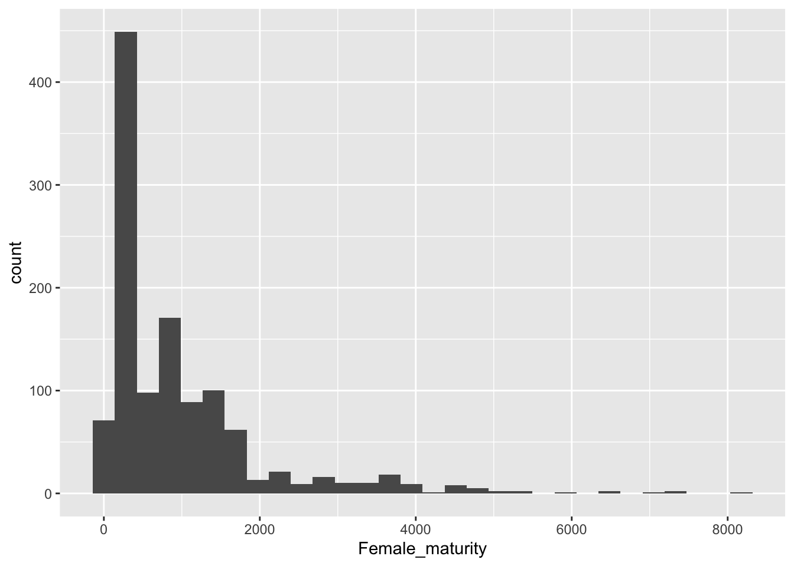

Here you can see a cluster of values near zero and a tail extending to the right. This is one indication that the data are not normally distributed.

Similarly, you can see this plot from Topic 2 and the tail of a few species in each class with a long maturation time.

``` r
p.fm2 <- ggplot(data=vertebrate_age,aes(x=Class, y=Female_maturity))

p.fm2 + geom_boxplot() +
   ylab("Female maturity (days)")
```

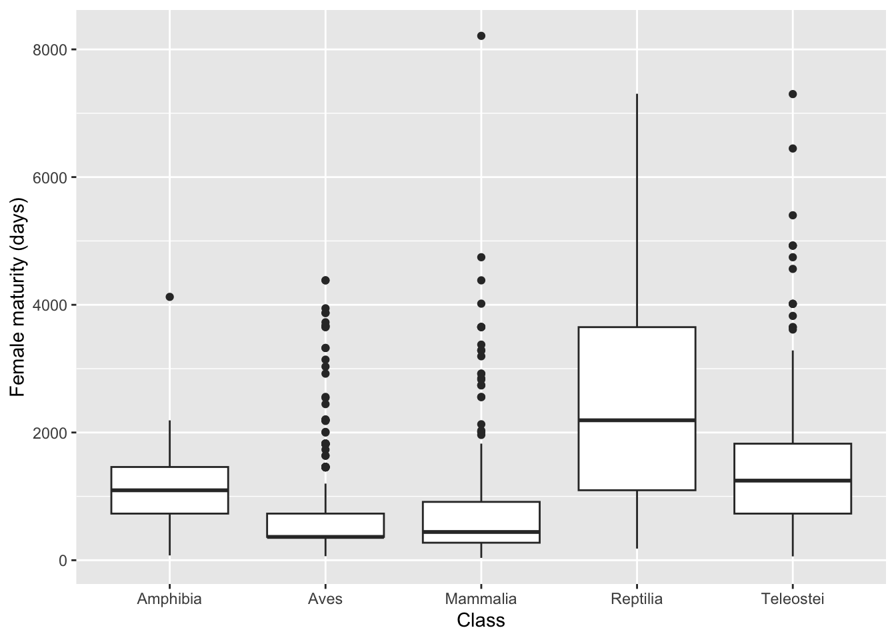

One thing we might be interested in is testing whether female maturity differs between vertebrate classes. Applying a linear model to the raw data is easy enough to do (but may not be the right thing to do).

``` r
mod.fm1 <- lm(Female_maturity ~ Class, data = vertebrate_age)
```

Now inspect the diagnostic plot with `plot(mod.fm1)`. The Q–Q plot curves away from the reference line, particularly at the upper end.

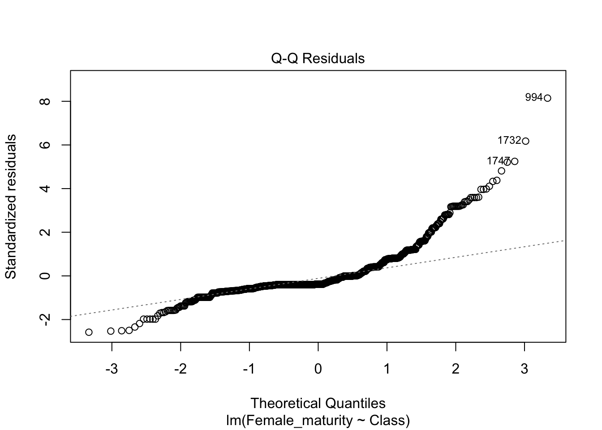

Real data do not fall exactly on the line, but this plot departs from it substantially in places. This suggests some residuals are much larger than expected under a normal distribution.

This becomes apparent if you plot a histogram of the residuals directly. For a reasonably well-fitted model, you should get something symmetrical.

``` r
hist(resid(mod.fm1))
```

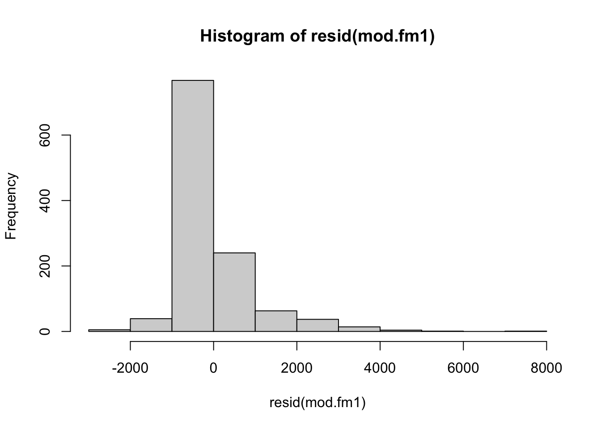

A log transformation may help. In Topic 2, we also plotted these data on a log axis. Here we fit a linear model to log-transformed female maturity. You can create a separate column in the data frame, or apply the transformation directly in `lm`.

``` r
mod.fm2 <- lm(log(Female_maturity) ~ Class, data = vertebrate_age)
plot(mod.fm2, which =2)
```

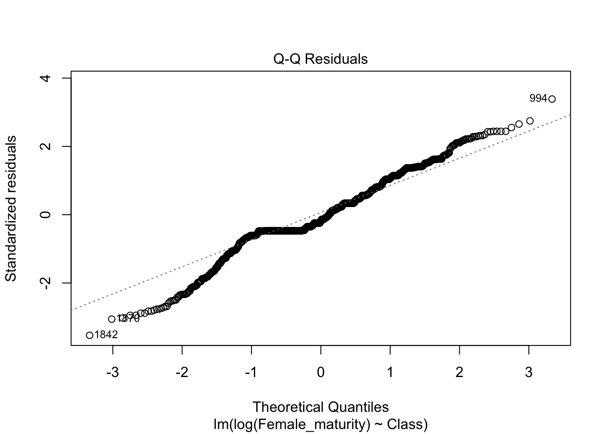

``` r
hist(resid(mod.fm2))
```

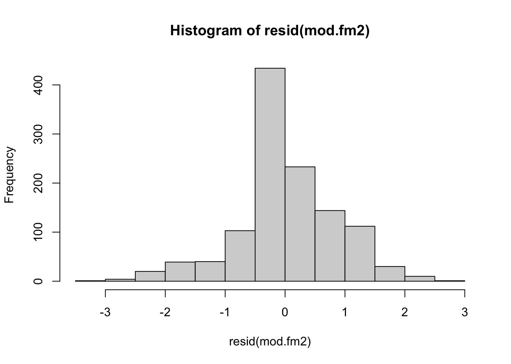

The log-transformed model fits these data better, although the lower end of the Q–Q plot still departs from the reference line. There are several ways to analyse non-normal data. In practice, residuals from real data are rarely perfectly normal, and linear models can be reasonably robust when residuals are not strongly skewed and there are no influential outliers. See [Knief and Forstmeier (2021)](https://pubmed.ncbi.nlm.nih.gov/33963496/) for a study of this issue. The log-transformed model is reasonable for this example, but its *p*-value should be treated cautiously, particularly if it is close to 0.05. Here, there is strong evidence that female maturity differs among vertebrate classes.

``` r
drop1(mod.fm2,test="F")
```

:::{dropdown} Show expected output
    ## Single term deletions
    ##
    ## Model:
    ## log(Female_maturity) ~ Class
    ##        Df Sum of Sq     RSS     AIC F value    Pr(>F)
    ## <none>               858.78 -353.12
    ## Class   4    224.44 1083.23  -89.23  76.184 < 2.2e-16 ***
    ## ---
    ## Signif. codes:  0 '***' 0.001 '**' 0.01 '*' 0.05 '.' 0.1 ' ' 1
:::

``` r
summary(mod.fm2)
```

:::{dropdown} Show expected output
    ##
    ## Call:
    ## lm(formula = log(Female_maturity) ~ Class, data = vertebrate_age)
    ##
    ## Residuals:
    ##     Min      1Q  Median      3Q     Max
    ## -3.0203 -0.4037 -0.1697  0.5122  2.9035
    ##
    ## Coefficients:
    ##                Estimate Std. Error t value Pr(>|t|)
    ## (Intercept)      6.8915     0.1108  62.201  < 2e-16 ***
    ## ClassAves       -0.5880     0.1190  -4.943 8.82e-07 ***
    ## ClassMammalia   -0.7817     0.1172  -6.668 4.00e-11 ***
    ## ClassReptilia    0.6643     0.1531   4.339 1.55e-05 ***
    ## ClassTeleostei   0.2231     0.1311   1.702    0.089 .
    ## ---
    ## Signif. codes:  0 '***' 0.001 '**' 0.01 '*' 0.05 '.' 0.1 ' ' 1
    ##
    ## Residual standard error: 0.8582 on 1166 degrees of freedom
    ##   (999 observations deleted due to missingness)
    ## Multiple R-squared:  0.2072, Adjusted R-squared:  0.2045
    ## F-statistic: 76.18 on 4 and 1166 DF,  p-value: < 2.2e-16
:::

## Exercise 1: Chlorophyll

The file <a href="/data/topic-7-generalised-linear-models/chlorophyll.txt?download=1" target="_blank" rel="noopener noreferrer">chlorophyll.txt</a> contains data on chlorophyll levels (mg/L) on a number of lakes, plus information on pH, water alkalinity (mg/L carbonate levels) and calcium concentration (mg/L).

Generate and present a minimal model that identifies the main driver(s) of
chlorophyll levels. This will involve what you’ve learnt in the previous model
selection topic as well as what you’ve learnt here in transforming data.

Note that there is more than one way to tackle this, and no single right
answer.


## Generalised linear models

Sometimes the nature of the data means that it is fundamentally non-normal or cannot be transformed to meet the assumptions of a linear model. This is particularly clear for count data, which can only take integer values of zero or greater.

For this reason, the linear model can be extended to the generalised linear model (GLM), using the linear predictor $\eta$ and the link function $g(\mu)$. The linear predictor combines the explanatory variables as a straight-line equation. The link function connects this predictor to the expected response, $g(\mu)=\eta$. A GLM assumes that the response follows its chosen distribution, such as a binomial or Poisson distribution; it does not assume normal errors around $\eta$.

$$
\eta = \beta_{0}+ \beta_{1}x_{1}+\beta_{2}x_{2}+...+\beta_{n}x_{n} \\
g(\mu) = \eta
$$

You will need to read [Chapter 13 of Crawley’s *The R Book*](https://liverpool.primo.exlibrisgroup.com/nde/fulldisplay?vid=44LIV_INST:NDE&search-location=library&tab=Everything&search_scope=MyInst_and_CI&lang=en&query=Chapter%2013%20of%20Crawley%20%E2%80%98The%20R%20Book%E2%80%99%20&docid=alma991014709529707351&adaptor=Local%20Search%20Engine&context=L&isFrbr=true&isHighlightedRecord=false&state=) to fully understand the concepts ([Wikipedia also has an explanation](https://en.wikipedia.org/wiki/Generalized_linear_model)).

Some of the common types of data you might see are:

*Continuous data*. This is familiar from previous topics and includes quantitative responses for which the model residuals are approximately normally distributed. A transformation, such as taking logs, can sometimes make this assumption more reasonable. These data can be analysed using a linear model (`lm`).

*Discrete data*. Counts may be bounded below by zero only ($0, 1, 2, \ldots$), in which case a Poisson distribution may be appropriate, or bounded between zero and a known total ($0, 1, 2, \ldots, n$), in which case a binomial distribution may be appropriate. If counts are large, a normal distribution may provide a reasonable approximation.

### What's my distribution?

Complete the **What's my distribution?** quiz before moving on. Choose an
answer for each question to receive immediate feedback.

<iframe id="distribution-quiz-frame" src="../../assets/topic-7/distribution-quiz.html?v=4" title="What's my distribution? interactive quiz" style="width: 100%; height: 650px; overflow: auto; border: 2px solid #64748b; border-radius: 0.5rem;" scrolling="yes" loading="lazy"></iframe>

<style>
.distribution-quiz {
  border: 1px solid var(--myst-border-color, #d1d5db);
  border-radius: 0.5rem;
  padding: 1rem 1.25rem;
  margin: 1.5rem 0;
}
.distribution-question {
  border-top: 1px solid var(--myst-border-color, #d1d5db);
  margin-top: 1.25rem;
  padding-top: 1.25rem;
}
.distribution-question:first-child {
  border-top: 0;
  margin-top: 0;
  padding-top: 0;
}
.distribution-question label {
  display: block;
  margin: 0.45rem 0;
}
.distribution-question button {
  border: 1px solid #464646;
  border-radius: 0.25rem;
  background: transparent;
  padding: 0.35rem 0.7rem;
  cursor: pointer;
}
.distribution-feedback {
  margin-top: 0.75rem;
  padding: 0.65rem 0.8rem;
  border-left: 4px solid #64748b;
}
</style>
<div class="distribution-quiz" style="display: none;">
  <div class="distribution-question">
    <p><strong>Question 1</strong></p>
    <p>Zombies are walking past my house. I have a bag of apples and I throw an apple at each zombie as it walks past. I record my hits and misses as follows:</p>
    <p><em>MISS MISS HIT MISS HIT HIT MISS HIT MISS HIT HIT ...etc</em></p>
    <p>What type of distribution best describes these data?</p>
    <label><input type="radio" name="distribution-q1" value="normal"> Normal distribution</label>
    <label><input type="radio" name="distribution-q1" value="binomial"> Binomial distribution</label>
    <label><input type="radio" name="distribution-q1" value="poisson"> Poisson distribution</label>
    <label><input type="radio" name="distribution-q1" value="gamma"> Gamma distribution</label>
    <button type="button" data-group="distribution-q1" data-correct="binomial" data-feedback="distribution-feedback-1">Check answer</button>
    <div id="distribution-feedback-1" class="distribution-feedback" aria-live="polite"></div>
  </div>

  <div class="distribution-question">
    <p><strong>Question 2</strong></p>
    <p>I have trained my 25 cats to weigh themselves every morning on the bathroom scales. This morning I plotted their distribution. What best describes this distribution?</p>
    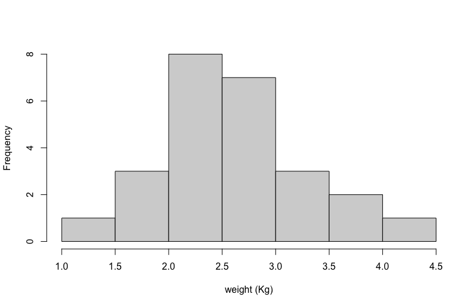
    <label><input type="radio" name="distribution-q2" value="normal"> Normal distribution</label>
    <label><input type="radio" name="distribution-q2" value="binomial"> Binomial distribution</label>
    <label><input type="radio" name="distribution-q2" value="negative-binomial"> Negative binomial distribution</label>
    <label><input type="radio" name="distribution-q2" value="poisson"> Poisson distribution</label>
    <button type="button" data-group="distribution-q2" data-correct="normal" data-feedback="distribution-feedback-2">Check answer</button>
    <div id="distribution-feedback-2" class="distribution-feedback" aria-live="polite"></div>
  </div>

  <div class="distribution-question">
    <p><strong>Question 3</strong></p>
    <p>Every morning I cycle to work. One week I decided to count the number of car drivers who make close passes (i.e. pass less than 1 m from my right elbow). What might describe this distribution?</p>
    <table>
      <thead><tr><th>Day</th><th>Number of close passes</th></tr></thead>
      <tbody>
        <tr><td>Monday</td><td>2</td></tr>
        <tr><td>Tuesday</td><td>0</td></tr>
        <tr><td>Wednesday</td><td>1</td></tr>
        <tr><td>Thursday</td><td>0</td></tr>
        <tr><td>Friday</td><td>3</td></tr>
        <tr><td>Saturday</td><td>0</td></tr>
        <tr><td>Sunday</td><td>1</td></tr>
      </tbody>
    </table>
    <label><input type="radio" name="distribution-q3" value="normal"> Normal distribution</label>
    <label><input type="radio" name="distribution-q3" value="binomial"> Binomial distribution</label>
    <label><input type="radio" name="distribution-q3" value="gamma"> Gamma distribution</label>
    <label><input type="radio" name="distribution-q3" value="poisson"> Poisson distribution</label>
    <button type="button" data-group="distribution-q3" data-correct="poisson" data-feedback="distribution-feedback-3">Check answer</button>
    <div id="distribution-feedback-3" class="distribution-feedback" aria-live="polite"></div>
  </div>
</div>

<div aria-hidden="true" style="height: 6rem;"></div>

## The Challenger example

Let’s look at a famous dataset from the Challenger disaster. Failure of the O-rings on the booster rockets led to an explosion and the loss of seven crew members.

Before the launch, the company (Morton-Thiokol) that made the boosters had data showing that launching in cold weather would likely be catastrophic. But they were unable to convince NASA to delay the launch. At least in part, this was because they had so little time to prepare a presentation that they presented a disparate series of graphs rather than one clear graph. We will follow an example modified from Faraway (2006).

The next three figures show the data as presented by the engineers. Can we do any better?

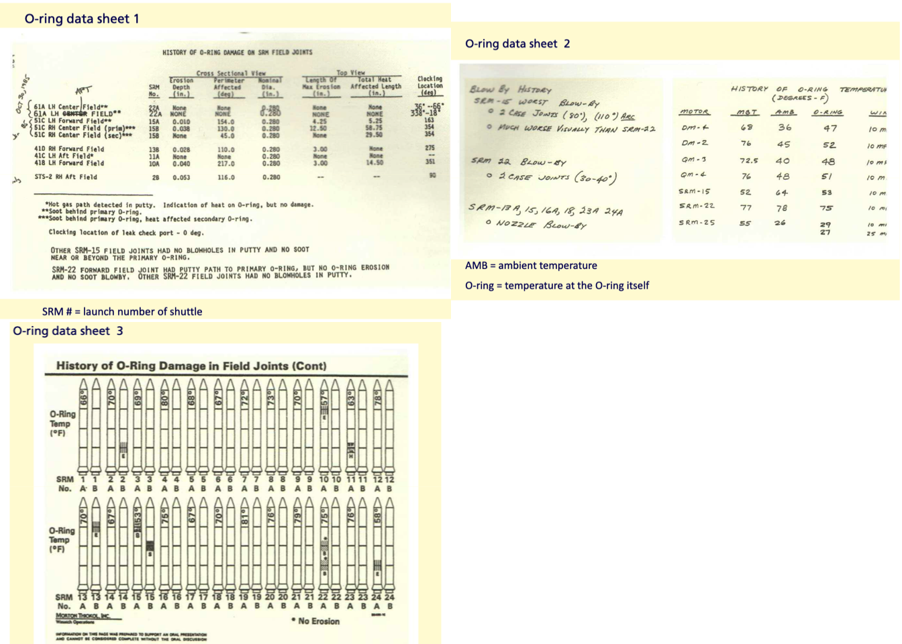


### Plotting the Challenger data

Read in the <a href="/data/topic-7-generalised-linear-models/orings.txt?download=1" target="_blank" rel="noopener noreferrer">orings.txt</a> file from Canvas and check it has been read in correctly.

Let’s plot the data and stick a straight line through it.

``` r
# What data we want to plot
oring.plot1 <- ggplot(data=orings, aes(x=temp,y=damage))

# plot the points
oring.plot1 + geom_point() +

  # put on informative axes labels
  xlab("Temperature (°F)") + ylab("Number of damaged O-rings") +

  # stick a straight line through it
  geom_smooth(method = "lm")
```

:::{dropdown} Show expected output
    ## `geom_smooth()` using formula = 'y ~ x'
:::

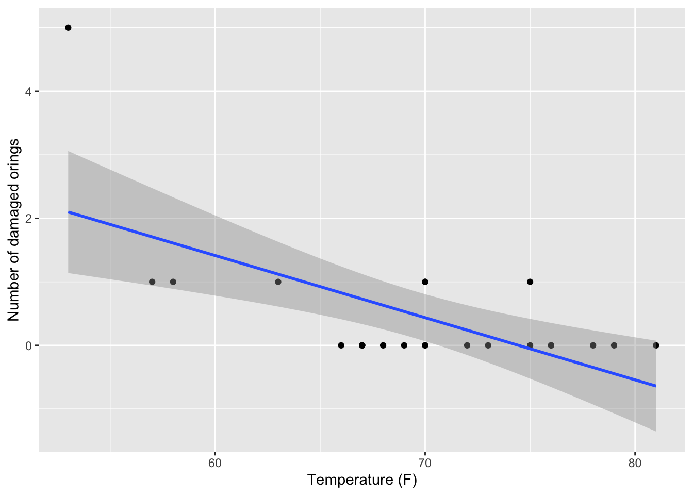

There are three O-rings per booster and two boosters per shuttle, so this plot shows the number of damaged O-rings on each launch against temperature in °F.

O-rings are treated as independent trials, but each launch tests six O-rings. We therefore model the number damaged on each launch as a binomial count out of six.

Most of the damaged O-rings appear at the colder temperatures, but simply plotting a straight line doesn’t work well since there can never be less than zero or more than 6 O-rings damaged on a launch.

An O-ring is either damaged or not; it cannot be partly damaged for this analysis. The number damaged on a launch is therefore a *binomial* variable, taking an integer value from 0 to 6. In this model, a “success” is a damaged O-ring, so its probability is between 0 and 1.

The logistic link models the log odds of an O-ring being damaged rather than the probability directly.

$$
\log\left(\frac{p(damaged)}{1-p(damaged)}\right)
$$


### Fitting a generalised linear model in R

Previously we’ve used the `lm` function for linear models. Here we use a similar syntax with `glm`. We specify the `family` argument as binomial and provide two columns of counts: damaged O-rings (successes) and undamaged O-rings (failures). The `cbind` function combines these columns, whose counts add to six for each launch.

``` r
#what the binomial response looks like going into the model
with(orings,head(cbind(damage, 6 - damage)))
```

:::{dropdown} Show expected output
    ##      damage
    ## [1,]      5 1
    ## [2,]      1 5
    ## [3,]      1 5
    ## [4,]      1 5
    ## [5,]      0 6
    ## [6,]      0 6
:::

``` r
#fitting the model
or1 <- glm(cbind(damage, 6 - damage) ~ temp, data = orings, family = "binomial")

#testing the significance of temperature
drop1(or1,test="Chisq")
```

:::{dropdown} Show expected output
    ## Single term deletions
    ##
    ## Model:
    ## cbind(damage, 6 - damage) ~ temp
    ##        Df Deviance    AIC    LRT  Pr(>Chi)
    ## <none>      16.912 33.675
    ## temp    1   38.898 53.660 21.985 2.747e-06 ***
    ## ---
    ## Signif. codes:  0 '***' 0.001 '**' 0.01 '*' 0.05 '.' 0.1 ' ' 1
:::

For a linear model, `drop1()` can use an *F*-test. For a GLM, it compares the change in deviance with a chi-squared distribution, so we use `test = "Chisq"`.

Let’s replot the data as the proportion of O-rings damaged, and add the model’s predicted probability of damage.

``` r
#Create a data frame for the model prediction
# we put in temperatures between 25 and 85 F and ask R to predict the probability of damage for each temperature
or.predict <- data.frame(temp = seq(25,85),
               pred.damage=predict(or1, type = "response", newdata = data.frame(temp = seq(25,85))))


# What data we want to plot
oring.plot1 <- ggplot(data=orings, aes(x=temp,y=damage/6))

# plot the points
oring.plot1 + geom_point() +

  # put on informative axes labels
  xlab("Temperature (°F)") + ylab("Proportion of damaged O-rings") +

  # set the limits of x and y axes beyond the range of the data (but to include the fatal launch temperature)
  ylim(c(0,1)) + xlim(c(25,85)) +

  # add a line for the probability of failure predicted by the model
  geom_line(data=or.predict,aes(x=temp,y=pred.damage)) +

  # the fatal launch was at 31F, let's plot this as a thick red line
  geom_vline(xintercept=31,col="red",linetype="dashed",linewidth=2)
```

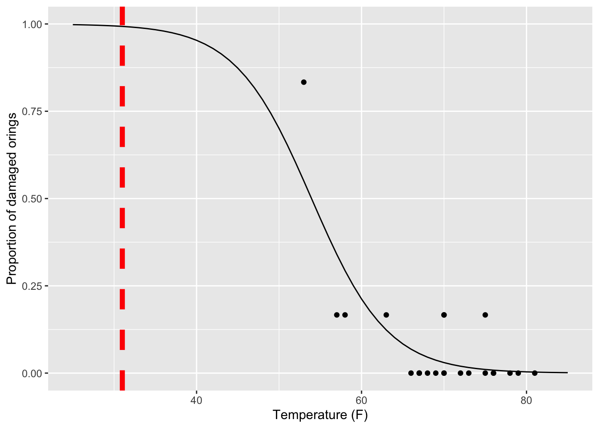

There are many caveats when extending a prediction beyond the range of the available data. Nevertheless, if you had this plot, would you choose to launch?


## Exercise 2: Turtle sex determination

Sex determination in turtles is dependent on the temperature at which eggs are incubated. Consider the data in the <a href="/data/topic-7-generalised-linear-models/turtle.txt?download=1" target="_blank" rel="noopener noreferrer">turtle.txt</a> file and describe this relationship.

## Exercise 3: Phage infection

Wild-type and a mutant bacterial strain were tested for their ability to gain antibiotic resistance following infection by a lysogenic phage, which integrates into the host genome and can alter the regulation of host genes. Counts of antibiotic-resistant bacteria in wild-type and mutant strains were collected in replicate experiments following phage infection.

Consider the data in <a href="/data/topic-7-generalised-linear-models/phage.txt?download=1" target="_blank" rel="noopener noreferrer">phage.txt</a> and perform an analysis to test for a difference in antibiotic resistance between wild-type and mutant bacterial strains.

## Exercise solutions

### Exercise 1: Chlorophyll

<div style="position: relative; width: 100%; height: 0; padding-bottom: 56.25%; margin: 1rem 0 2rem;">
  <iframe src="https://liverpool.cloud.panopto.eu/Panopto/Pages/Embed.aspx?id=96f3d625-76e2-4a97-a0ce-b228008839f4&amp;autoplay=false&amp;offerviewer=true&amp;showtitle=true&amp;showbrand=true&amp;captions=true&amp;interactivity=all" style="border: 1px solid #464646; position: absolute; top: 0; left: 0; width: 100%; height: 100%; box-sizing: border-box;" allowfullscreen allow="autoplay" aria-label="Panopto Embedded Video Player" aria-description="Chlorophyll exercise video"></iframe>
</div>

Start by reading the data and inspecting the variables. Histograms of the raw and log-transformed measurements help assess whether a transformation makes the response and predictors easier to model.

```r
# Read chlorophyll.txt from your working directory.
chlorophyll <- read.table("chlorophyll.txt", header = TRUE)

# Check the range and distribution of each variable.
summary(chlorophyll)
```

:::{dropdown} Show expected output
    ##     Lake            Chlorophyll           pH          Alkalinity
    ##  Length:53          Min.   :  0.70   Min.   :3.600   Min.   :  1.20
    ##  Class :character   1st Qu.:  4.60   1st Qu.:5.800   1st Qu.:  6.60
    ##  Mode  :character   Median : 12.80   Median :6.800   Median : 19.60
    ##                     Mean   : 23.12   Mean   :6.591   Mean   : 37.53
    ##                     3rd Qu.: 24.70   3rd Qu.:7.400   3rd Qu.: 66.50
    ##                     Max.   :152.40   Max.   :9.100   Max.   :128.00
    ##     Calcium
    ##  Min.   : 1.1
    ##  1st Qu.: 3.3
    ##  Median :12.6
    ##  Mean   :22.2
    ##  3rd Qu.:35.6
    ##  Max.   :90.7
:::

```r
# Compare the raw distributions with log-transformed distributions.
# Arrange all six histograms in one figure so their shapes can be compared.
old_par <- par(mfrow = c(2, 3))
hist(chlorophyll$Chlorophyll, main = "Chlorophyll", xlab = "mg/L")
hist(log(chlorophyll$Chlorophyll), main = "Log chlorophyll", xlab = "log(mg/L)")
hist(chlorophyll$Calcium, main = "Calcium", xlab = "mg/L")
hist(log(chlorophyll$Calcium), main = "Log calcium", xlab = "log(mg/L)")
hist(chlorophyll$Alkalinity, main = "Alkalinity", xlab = "mg/L")
hist(log(chlorophyll$Alkalinity), main = "Log alkalinity", xlab = "log(mg/L)")
par(old_par)
```

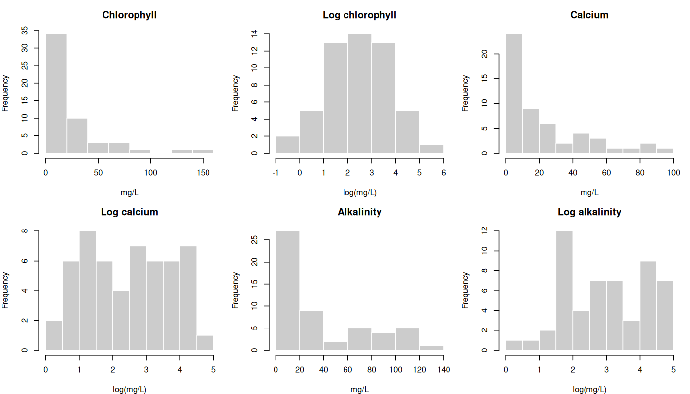

The exploratory plots support modelling chlorophyll on a log scale. They also suggest considering log calcium, while the appropriate scale for alkalinity is less clear. The code below compares two plausible starting models: one keeps alkalinity on its original scale and the other logs it. Each includes all two-way interactions among the explanatory variables.

```r
# Candidate model 1: log-transform chlorophyll and calcium.
ch1 <- lm(log(Chlorophyll) ~ (pH + log(Calcium) + Alkalinity)^2,
          data = chlorophyll)

# Candidate model 2: also log-transform alkalinity.
ch2 <- lm(log(Chlorophyll) ~ (pH + log(Calcium) + log(Alkalinity))^2,
          data = chlorophyll)

# Compare the model summaries, including their R-squared values.
summary(ch1)
summary(ch2)
```

:::{dropdown} Show expected output
    ## Model 1 (alkalinity untransformed):
    ## Multiple R-squared = 0.5066; adjusted R-squared = 0.4422
    ## Model 2 (log alkalinity):
    ## Multiple R-squared = 0.4938; adjusted R-squared = 0.4277
:::

The first model has a slightly higher R-squared, so use it as the starting point for model selection. The answer uses `step()` to shorten the backward search. It removes terms using AIC, but this is a shortcut rather than a guarantee that the result is the only minimal adequate model. Check the selected model with `drop1()` and inspect its residuals.

```r
# Search from the first candidate model by removing terms that improve AIC.
# The default trace shows the terms considered at each step.
ch3 <- step(ch1)

# Test the effect of deleting each remaining term from the selected model.
drop1(ch3, test = "F")

# Display the formula selected by the AIC search.
formula(ch3)

# Inspect the retained coefficients and overall model fit.
summary(ch3)

# Check the normality pattern of the model residuals.
plot(ch3, which = 2)
```

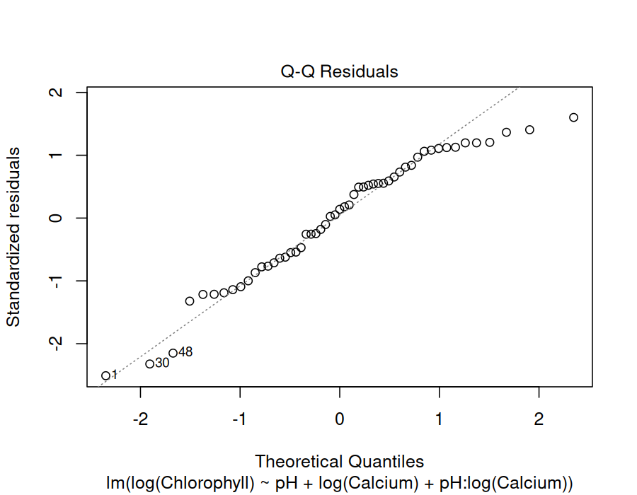

:::{dropdown} Show expected output
    ## Selected model:
    ## log(Chlorophyll) ~ pH + log(Calcium) + pH:log(Calcium)
    ##
    ##                 Estimate Std. Error t value Pr(>|t|)
    ## (Intercept)       0.7877     1.3952   0.565   0.5750
    ## pH                0.2181     0.2480   0.880   0.3834
    ## log(Calcium)     -1.4836     0.6521  -2.275   0.0273 *
    ## pH:log(Calcium)   0.2200     0.0942   2.335   0.0237 *
    ##
    ## Deleting pH:log(Calcium): F = 5.454, p = 0.02366
    ## Adjusted R-squared: 0.4475
:::

The interaction can also be viewed by plotting chlorophyll against calcium on log-scaled axes, with lakes separated into acidic and alkaline groups.

```r
library(ggplot2)

# Label lakes with pH below 7 as acidic and pH 7 or above as alkaline.
chlorophyll$pH_group <- factor(
  ifelse(chlorophyll$pH < 7, "Acidic (pH < 7)", "Alkaline (pH >= 7)"),
  levels = c("Acidic (pH < 7)", "Alkaline (pH >= 7)")
)

# Compare the calcium–chlorophyll pattern within each pH group.
ggplot(chlorophyll, aes(x = Calcium, y = Chlorophyll)) +
  geom_point() +
  scale_x_log10() +
  scale_y_log10() +
  facet_wrap(~pH_group) +
  labs(x = "Calcium (mg/L; log scale)",
       y = "Chlorophyll (mg/L; log scale)") +
  theme_bw()
```

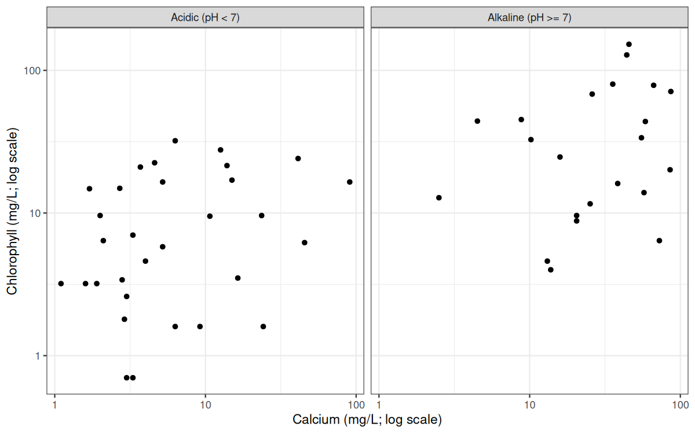

**Interpretation.** One adequate model retains pH, log calcium, and their interaction; alkalinity is removed during selection. The interaction is supported by the deletion test (*F* = 5.45, *p* = 0.024), which means the association between calcium and chlorophyll changes with pH. The plot suggests that chlorophyll is generally higher in alkaline lakes and that the calcium relationship is most apparent there. The fitted model explains about 45% of the variation in log chlorophyll after adjusting for the number of terms (adjusted *R*² = 0.448). These are associations in this dataset, not evidence that changing pH or calcium would cause chlorophyll levels to change.

### Exercise 2: Turtle sex determination

<div style="position: relative; width: 100%; height: 0; padding-bottom: 56.25%; margin: 1rem 0 2rem;">
  <iframe src="https://liverpool.cloud.panopto.eu/Panopto/Pages/Embed.aspx?id=46a8e445-e477-45cc-8510-b22800922165&amp;autoplay=false&amp;offerviewer=true&amp;showtitle=true&amp;showbrand=true&amp;captions=true&amp;interactivity=all" style="border: 1px solid #464646; position: absolute; top: 0; left: 0; width: 100%; height: 100%; box-sizing: border-box;" allowfullscreen allow="autoplay" aria-label="Panopto Embedded Video Player" aria-description="Turtle exercise video"></iframe>
</div>

The response is the number of female and male turtles observed at each temperature. Plot the observed proportion of females first, then fit a binomial model to the two counts.

```r
library(ggplot2)

# Read the turtle counts and inspect a few rows.
turtle <- read.table("turtle.txt", header = TRUE)
head(turtle)
```

:::{dropdown} Show expected output
    ##   temp male female
    ## 1 27.2    1      9
    ## 2 27.2    0      8
    ## 3 27.2    1      8
    ## 4 27.7    7      3
    ## 5 27.7    4      2
    ## 6 27.7    6      2
:::

```r
# Plot the observed proportion female at each recorded temperature.
turtle_plot <- ggplot(turtle, aes(x = temp, y = female / (female + male)))
turtle_plot +
  geom_point() +
  scale_x_continuous(limits = c(27, 30)) +
  scale_y_continuous(limits = c(0, 1)) +
  labs(x = "Temperature (°C)", y = "Proportion female") +
  theme_bw()
```

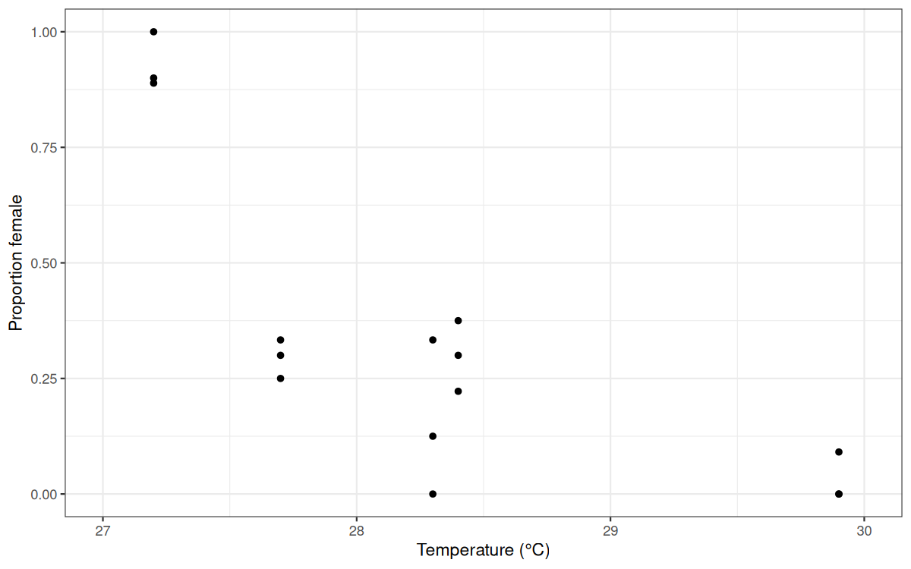

Each observation is a pair of counts. In `cbind(female, male)`, the first column is the number of successes (females) and the second is the number of failures (males). `family = binomial` fits a logistic regression, which keeps predicted probabilities between zero and one.

```r
# Model the probability of a female hatchling as a linear function of temperature
# on the log-odds scale.
turtle_mod <- glm(cbind(female, male) ~ temp,
                  data = turtle,
                  family = binomial)

# Inspect the coefficient estimates and test whether temperature contributes.
summary(turtle_mod)
drop1(turtle_mod, test = "Chisq")

# Convert the temperature coefficient from a change in log-odds to an odds ratio.
exp(coef(turtle_mod)["temp"])

# Predict female probabilities across the observed temperature range.
turtle_pred <- data.frame(temp = seq(27, 30, length.out = 100))
turtle_pred$prob_female <- predict(turtle_mod,
                                  newdata = turtle_pred,
                                  type = "response")

# Add the model's predicted probability curve to the observed proportions.
turtle_plot +
  geom_point() +
  geom_line(data = turtle_pred,
            aes(x = temp, y = prob_female),
            linewidth = 1) +
  scale_x_continuous(limits = c(27, 30)) +
  scale_y_continuous(limits = c(0, 1)) +
  labs(x = "Temperature (°C)", y = "Probability of a female hatchling") +
  theme_bw()
```

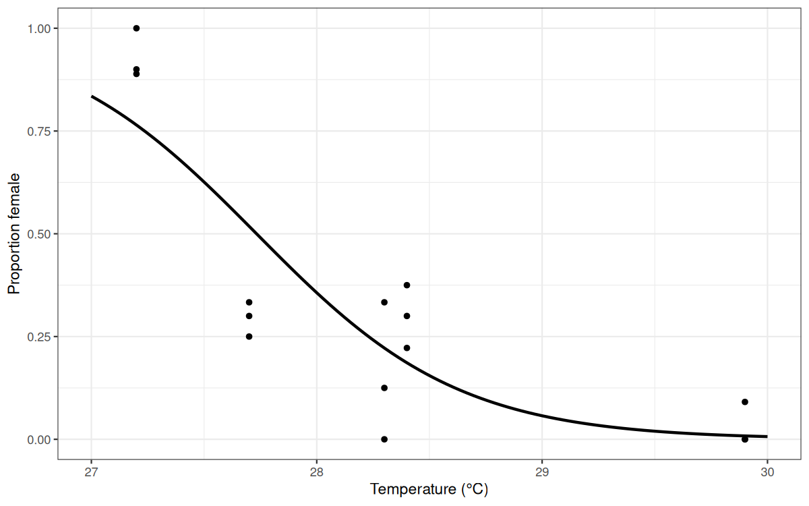

:::{dropdown} Show expected output
    ##             Estimate Std. Error z value  Pr(>|z|)
    ## (Intercept)  61.3183    12.0224   5.100  3.39e-07
    ## temp         -2.2110     0.4309  -5.132  2.87e-07
    ##
    ## Likelihood-ratio test for removing temp: p = 1.919e-12
    ## Odds ratio for a 1 °C increase: exp(-2.211) = 0.110
:::

**Interpretation.** Temperature is strongly associated with the proportion of female turtles (*p* < 0.001 in the likelihood-ratio test). In these data, the fitted probability of a female hatchling decreases as incubation temperature rises. The estimated odds of a female are multiplied by about 0.11 for each 1 °C increase. The plotted curve makes the direction of the relationship clear; the sign of a logistic-regression coefficient alone can be difficult to interpret.

### Exercise 3: Phage infection

<div style="position: relative; width: 100%; height: 0; padding-bottom: 56.25%; margin: 1rem 0 2rem;">
  <iframe src="https://liverpool.cloud.panopto.eu/Panopto/Pages/Embed.aspx?id=da9bc7d6-a467-40c0-bd94-b22800943b61&amp;autoplay=false&amp;offerviewer=true&amp;showtitle=true&amp;showbrand=true&amp;captions=true&amp;interactivity=all" style="border: 1px solid #464646; position: absolute; top: 0; left: 0; width: 100%; height: 100%; box-sizing: border-box;" allowfullscreen allow="autoplay" aria-label="Panopto Embedded Video Player" aria-description="Phage exercise video"></iframe>
</div>

These are counts of resistant bacteria, so the observations are non-negative integers with no fixed upper limit. A Poisson GLM is a suitable starting model for comparing the expected counts between the two treatments.

```r
library(ggplot2)

# Read the replicate counts and inspect the values and treatment groups.
phage <- read.table("phage.txt", header = TRUE)
head(phage)
summary(phage)
```

:::{dropdown} Show expected output
    ##   treatment count
    ## 1        WT     0
    ## 2        WT     1
    ## 3        WT     1
    ## 4        WT     0
    ## 5        WT     1
    ## 6        WT     1
    ##
    ##     treatment             count
    ##  Length:40          Min.   :0.000
    ##  Class :character   1st Qu.:0.000
    ##  Mode  :character   Median :1.000
    ##                     Mean   :1.175
    ##                     3rd Qu.:2.000
    ##                     Max.   :3.000
:::

```r
# Set wild type as the reference group for the treatment comparison.
phage$treatment <- factor(phage$treatment, levels = c("WT", "mutant"))

# Plot the replicate counts to compare their distributions between treatments.
ggplot(phage, aes(x = treatment, y = count)) +
  geom_boxplot() +
  geom_jitter(width = 0.15, height = 0) +
  labs(x = "Bacterial strain", y = "Antibiotic-resistant bacteria") +
  theme_bw()
```

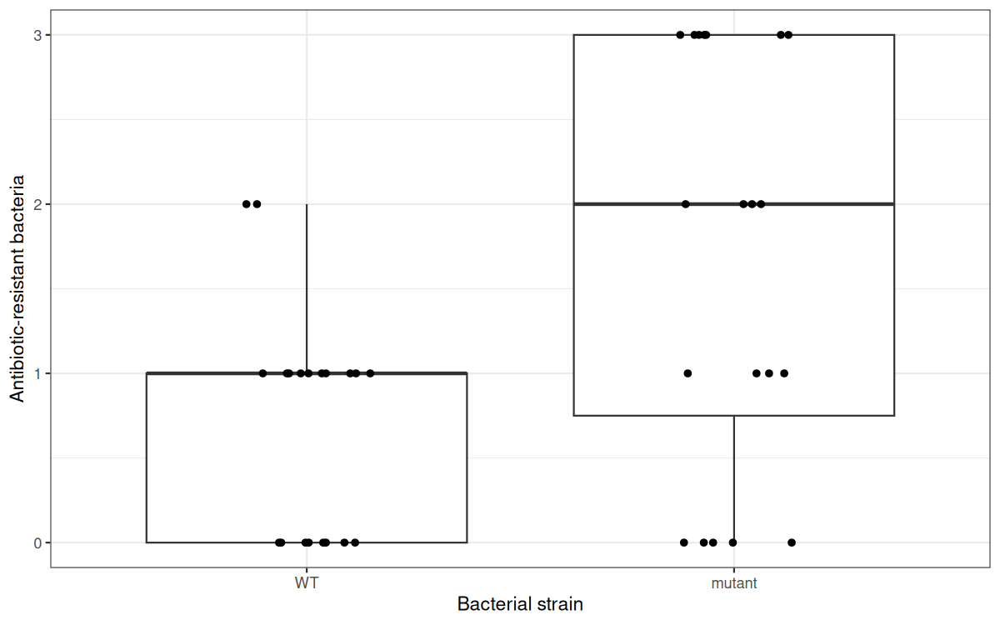

The Poisson model uses a log link. Its treatment coefficient is therefore a difference in log expected counts; exponentiating it gives the ratio of expected counts for mutant bacteria relative to wild type.

```r
# Fit a Poisson GLM with wild type as the reference treatment.
phage_mod <- glm(count ~ treatment,
                 data = phage,
                 family = poisson)

# Inspect the fitted coefficients and compare the model with and without treatment.
summary(phage_mod)
drop1(phage_mod, test = "Chisq")

# Exponentiate the treatment coefficient to get the mutant-to-wild-type count ratio.
exp(coef(phage_mod)["treatmentmutant"])
```

:::{dropdown} Show expected output
    ##                 Estimate Std. Error z value Pr(>|z|)
    ## (Intercept)      -0.3567     0.2673  -1.335  0.18202
    ## treatmentmutant   0.8575     0.3190   2.688  0.00718
    ##
    ## Likelihood-ratio test for treatment: p = 0.00493
    ## Mutant-to-wild-type expected-count ratio: exp(0.8575) = 2.36
:::

**Interpretation.** The likelihood-ratio test gives evidence that the expected number of resistant bacteria differs between strains (*p* = 0.0049). The positive treatment coefficient means the expected count is higher for the mutant strain. The fitted model estimates about 2.36 times as many resistant bacteria in mutant replicates as in wild-type replicates. This describes the difference in these experimental counts.

## References

Crawley, M. J. *The R Book*, Chapter 13. [University of Liverpool library record](https://liverpool.primo.exlibrisgroup.com/nde/fulldisplay?vid=44LIV_INST:NDE&search-location=library&tab=Everything&search_scope=MyInst_and_CI&lang=en&query=Chapter%2013%20of%20Crawley%20%E2%80%98The%20R%20Book%E2%80%99%20&docid=alma991014709529707351&adaptor=Local%20Search%20Engine&context=L&isFrbr=true&isHighlightedRecord=false&state=).

Faraway, J. J. (2006). [*Extending the Linear Model with R: Generalized Linear, Mixed Effects and Nonparametric Regression Models*](https://www.taylorfrancis.com/books/9780203492284). Chapman & Hall/CRC. DOI: 10.1201/b15416.

Knief, U., & Forstmeier, W. (2021). [Violating the normality assumption may be the lesser of two evils](https://pubmed.ncbi.nlm.nih.gov/33963496/). *Behavior Research Methods, 53*(6), 2576–2590. DOI: 10.3758/s13428-021-01587-5.
